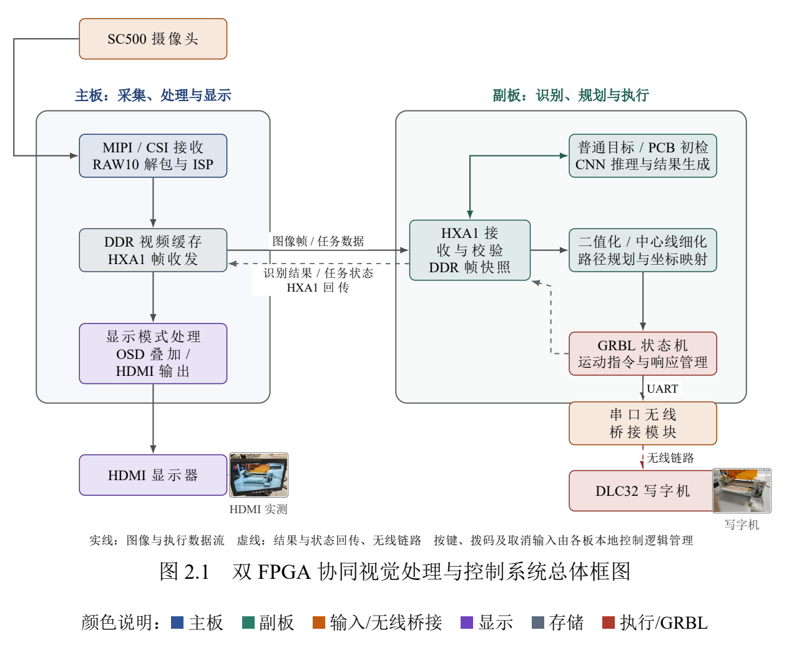
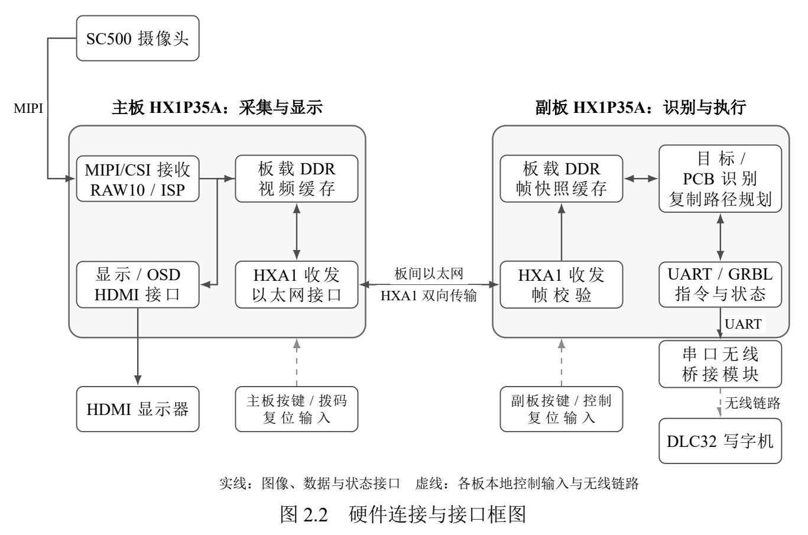
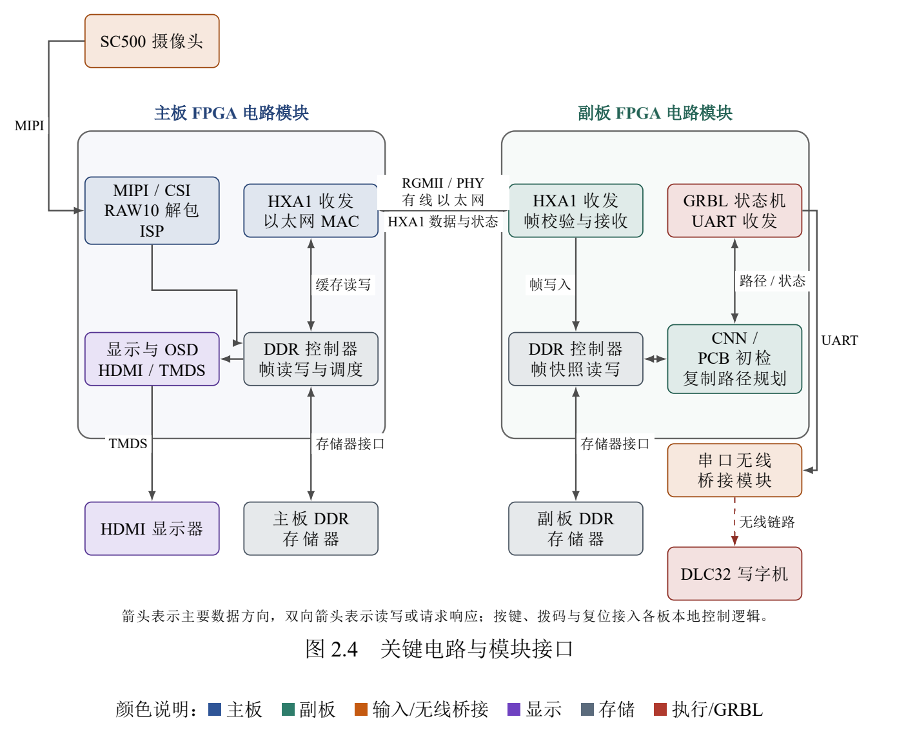
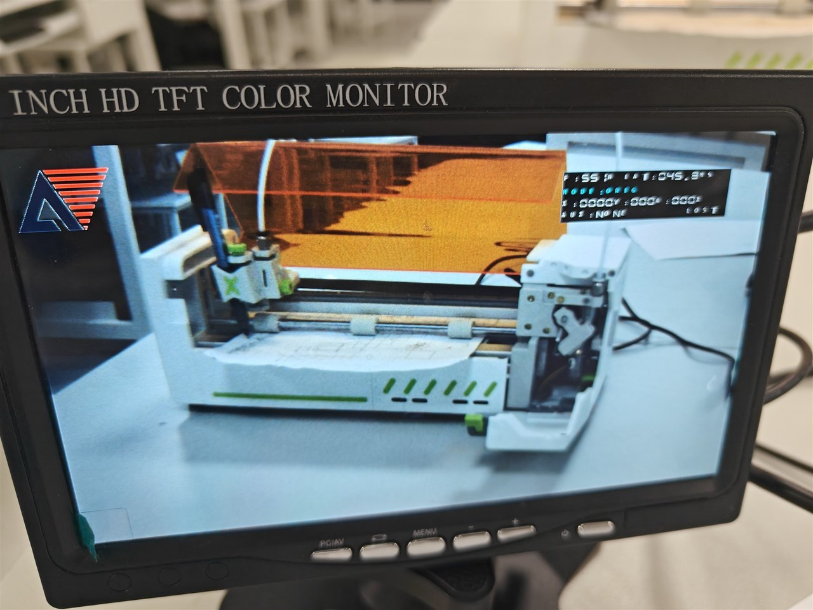
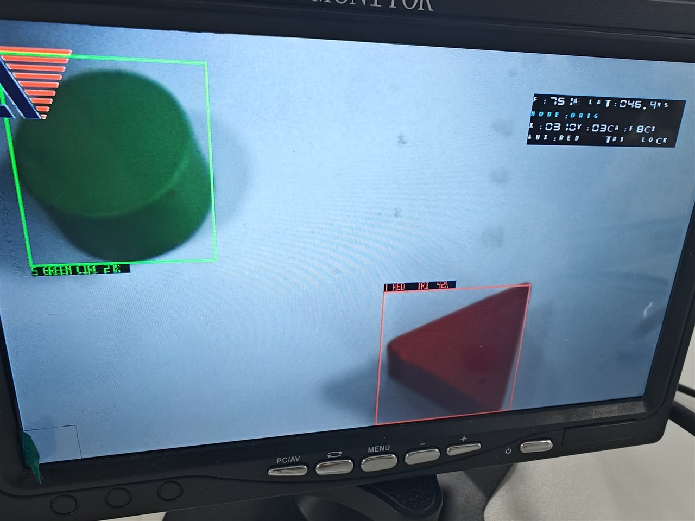
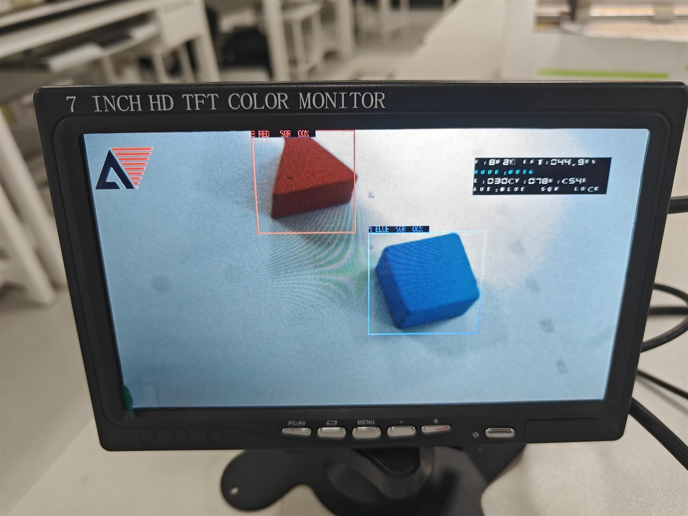
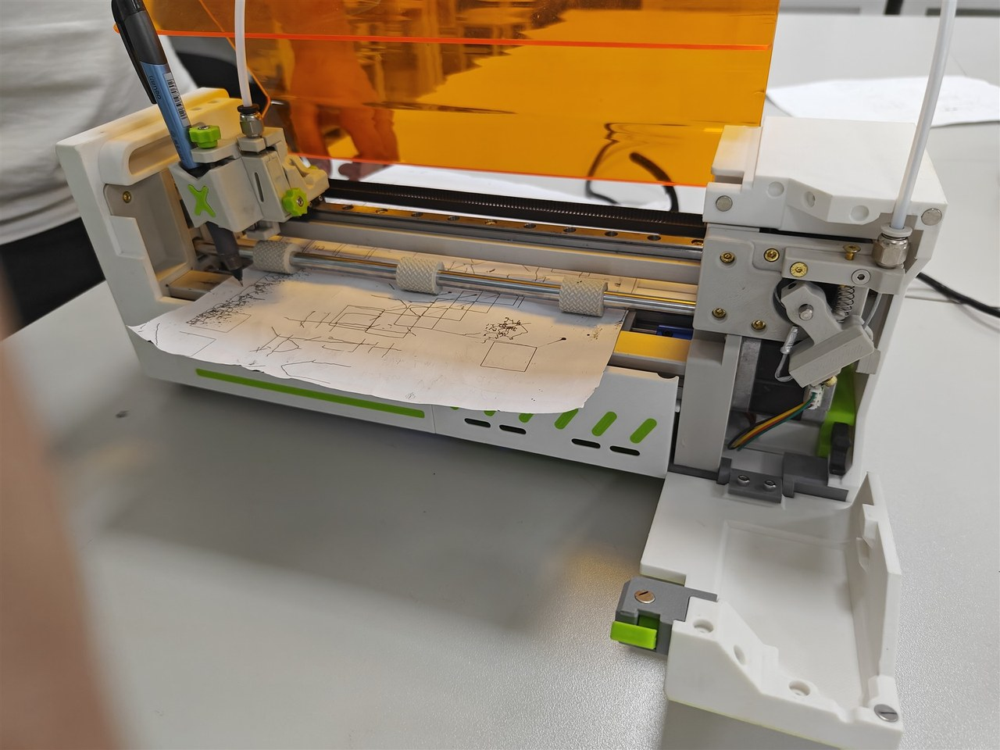
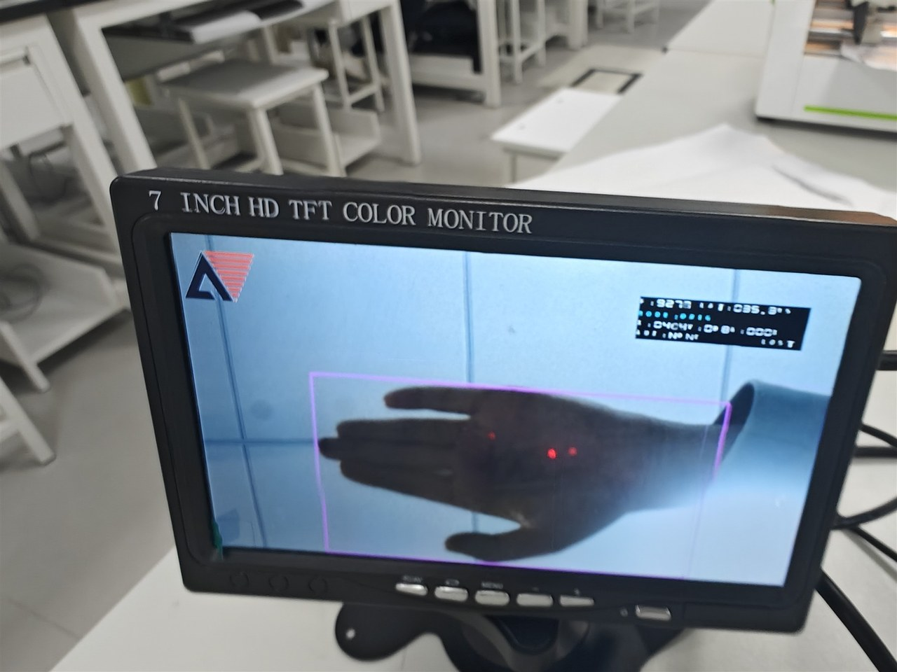
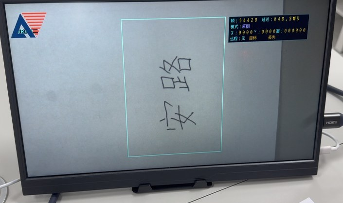
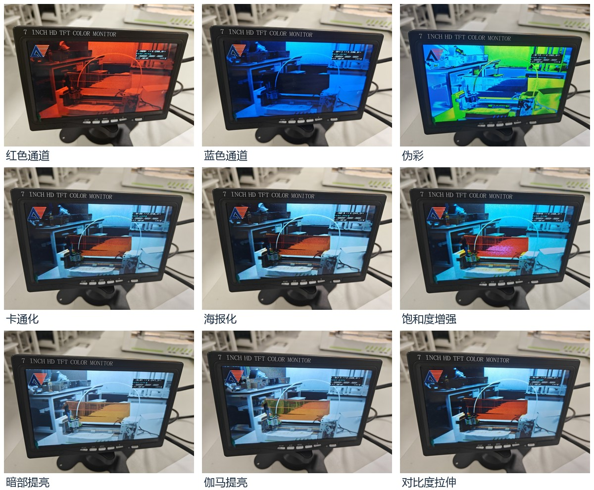

# 视觉识别质检与控制描摹系统

**Vision Inspection, Control & Tracing System · Dual-FPGA · FPGA 创新设计大赛参赛工程**

基于 HX1P35A 平台的双 FPGA 视觉与执行系统。主板采集 SC500 720p 图像，完成图像风格化、运动区域检测、成像调节与 HDMI 叠加；副板执行普通 CNN、PCB 二分类和手写笔迹中心线提取，经串口无线桥接驱动 GRBL 写字机。

识别结果可以显示在屏幕上，也可以写成纸面报告；文档模式直接把图像笔迹转换为路径，不做 OCR。报告使用单线矢量字模，支持一次 X 镜像、按内容高度换行和纸张维护。已接受的写字任务由副板持有，板间断网不自动取消或重放。

## 当前版本：2026-11-18

主板最多四个目标分别显示名称、分数和中心坐标，随识别显示一起开关。副板修复后台 CNN 阻挡 KEY2，增加启动与安全空闲串口保护；报告相连转角连续落笔，书写进给保持 5000 mm/min。

- [下载可直接转发的源码工程包，约 25.2 MiB](https://github.com/yujiwei-777/dual-fpga-vision-plotter/releases/download/v2026.11.18-multicoord-idle/vision_plotter_multicoord_idle_20261118.zip)：含配套 bit、源工程、模型、约束、仿真材料、构建报告和中文使用页。
- [版本说明与验证范围](docs/MULTICOORD_IDLE_20261118.md) · [接线与操作](docs/HARDWARE_AND_CONTROL.md)

解压后打开 `00_开始使用.html`；开发前使用 `prepare_projects.py` 生成新副本。配套工程为 main_cnn_multicoord_20261118 与 secondary_plotter_idle_preflight_20261118，两板构建通过，实板 **NOT_RUN**。

## 系统结构



总体框图提取自技术文档第 5 页，展示模块分工与数据流。[简版架构图](docs/assets/system-architecture.png) · [简版 SVG 矢量图](docs/assets/system-architecture.svg)

<details>
<summary>展开硬件连接与模块接口图</summary>

硬件连接与接口（技术文档第 6 页）：



关键电路与模块接口（技术文档第 8 页）：



这些图保留文档中的概念性连接，具体 RTL 支路、模式及按键操作见[当前版本说明](docs/MULTICOORD_IDLE_20261118.md)。

</details>

## 实拍展示

| HDMI 图像采集与显示 | 多目标识别与信息叠加 |
| --- | --- |
|  |  |
| **不同物块识别** | **写字机执行平台** |
|  |  |

照片取自项目开发阶段的实拍记录，画面中的 OSD 为当时版本。更多图像处理效果及文档路径回放见 [演示图集](docs/GALLERY.md)。

| 局部运动检测 | 手写笔迹采集 |
| --- | --- |
|  |  |

图像风格化与增强效果：



以上新增图片提取自 2026-11-02 技术文档；完整 18 种效果、CNN 样本和历史 PCB 取景画面见[图集](docs/GALLERY.md#技术文档补充图片)。
## 技术说明与答辩资料

[在线阅读](docs/defense_20261114/技术说明与答辩参考.md) · [PDF（48 页）](docs/defense_20261114/技术说明与答辩参考.pdf) · [Word 可编辑版](docs/defense_20261114/技术说明与答辩参考.docx)

V1.1 算法详解版，覆盖架构、图像处理、CNN、PCB、文档描摹、写字控制与 32 个答辩问答，配图和引用索引见[资料目录](docs/defense_20261114/)。

## 技术特点

1. **双 FPGA 分工与板间闭环。** 主板负责采集、显示和任务调度，副板负责推理、路径规划和执行器通信；以太网传输图像及结果，UART 逐行等待 GRBL 应答。
2. **普通 CNN 与 PCB 独立处理。** 普通目标采用 64×64 RGB8、9 类轻量网络与连续确认，输出名称、原图中心坐标和实际 margin；PCB 先做 CCL 候选定位，再以 96×96 Y8 执行 GOOD/BAD 判定，低证据结果为 REVIEW。
3. **图像笔迹直接转机器路径。** 320×180 网格按 4×4 源块判定，经过骨架提取、端点优先和分叉拆笔生成中心线；取原图中央宽高各 80%，外围留空，不拉伸，无需纸张四角定位。
4. **识别与书写状态分离。** KEY1 接纳锁存结果或准备路径；断网不重复启动。串口异常、安全停止与复位使用独立状态保护，已发运动命令不盲目重发。
5. **纸面报告与纸张维护。** 单线矢量字体、相邻同笔段连续书写、统一镜像与自动换行；有限纸面额度关闭，由操作者管理剩余纸面，KEY2 长按退纸、KEY1 长按确认新纸，维护只动 Y，保留 X 基准。
6. **显示与成像处理。** 图像风格化采用传统定点算子；显示支路保边空间滤波配合曝光/增益/白平衡统计控制。主板保留运动叠加、左下 PCB 状态与按需中文操作面板。

PCB 是整板辅助二分类，不能作为精确缺陷分割；CNN margin 不是校准概率。文档几何中心线不等同于汉字标准笔顺。

## 模式与按键

| 主板 SW4:SW3 | 模式 | 操作 |
| --- | --- | --- |
| 00 | 普通 CNN | 显示结果，副板 KEY1 短按书写已锁存报告 |
| 01 | PCB | 主板 KEY4 每次稳定按下识别一次，副板 KEY1 短按写报告 |
| 10 | 文档 | 完整接收并准备路径后，副板 KEY1 短按提交描摹 |
| 11 | 保留 | 暂无功能 |

本版 SW2 控制信息叠加，板间网络固定连接副板。副板 KEY2 短按画方框并换行，长按至少 2 秒退纸；人工放新纸后长按 KEY1 上纸确认。副板 KEY3 复位整个应用，KEY4 用于写字任务停止/重置。主板 KEY4 与副板 KEY4 功能不同。完整流程见[操作说明](docs/HARDWARE_AND_CONTROL.md)。

## 工程与校验

当前源码位于 [hardware_versions/20261118_multicoord_idle](hardware_versions/20261118_multicoord_idle/)。两板器件 PH1P35MDG324、speed -3；构建工具 Tang Dynasty Release 2026.1 SP2 / 6.2.200067。

```text
01_bit/                 当前配套 bit
02_projects/main/       主板冻结输入、IP、约束与证据
02_projects/secondary/  副板冻结输入、模型、仿真与证据
03_docs/                中文使用与开发说明
04_verification/        配对身份及验证范围
```

在仓库根目录运行 `python -B verify_release.py` 校验各历史归档；在当前版本目录运行 `python -B verify_package.py` 只校验本版。校验不需要 FPGA 工具。开发前按[工程说明](hardware_versions/20261118_multicoord_idle/03_docs/工程打开与开发.md)创建适配路径的独立副本。

| 板卡 | Setup WNS | Hold WNS | TNS | Slice | ERAM | DSP |
| --- | --- | --- | --- | --- | --- | --- |
| 多目标坐标主板 | +0.314 ns | +0.020 ns | 0 | 93.38% | 89.81% | 92.50% |
| 空闲通信保护副板 | +0.006 ns | +0.020 ns | 0 | 89.99% | 78.70% | 40.00% |

共 543 项冻结输入与指定 bit 已核对；最终资源、时序、DRC、只读 reimport 和 bitgen 证据保留，交付包解压、路径适配及 20 项定向仿真通过。副板 setup 余量仅 6 ps；实板仍为 NOT_RUN。[详细验证范围](docs/MULTICOORD_IDLE_20261118.md#构建与实板状态)。

## 历史版本与资料

[2026-11-13 SUSPECT 与纸张维护](docs/SUSPECT_PAPER_20261113.md) · [2026-11-03 显示滤波与 KEY1 报告](docs/DISPLAY_NOISE_KEY1_20261103.md) · [CCL 二分类](docs/CCL_BINARY_RETRAINED_20261103.md) · [pose7](docs/POSE7_AUTO_20261102.md) · [2026-11-01](hardware/)

当前风格环为 16 档（保留原编号 0–4、6–14、17、18）。历史图像处理算法见 [风格化、运动检测与成像调节](docs/VERSION_SCOPE.md#图像风格化运动检测与成像调节)；历史实测结论见 [验证记录](docs/VALIDATION.md)，不自动适用于后续 bit。

## 版权与使用

原创 RTL、脚本和文档采用 [MIT 许可证](LICENSE)。厂商 IP、第三方模块、模型、图片及工具输出保留各自授权范围，不因仓库采用 MIT 而重新授权，见[第三方说明](docs/THIRD_PARTY_NOTICES.md)。工具、许可证、原始训练数据与无线桥接固件需另行准备。


## 技术文档与演示视频

- [技术文档 PDF（2026-11-02）](docs/assets/视觉识别质检与控制描摹系统_技术文档_20261102.pdf)
- [项目演示视频（约 256 MiB）](https://github.com/yujiwei-777/dual-fpga-vision-plotter/releases/download/v2026.11.18-multicoord-idle/vision_plotter_demo_group1.mp4)
