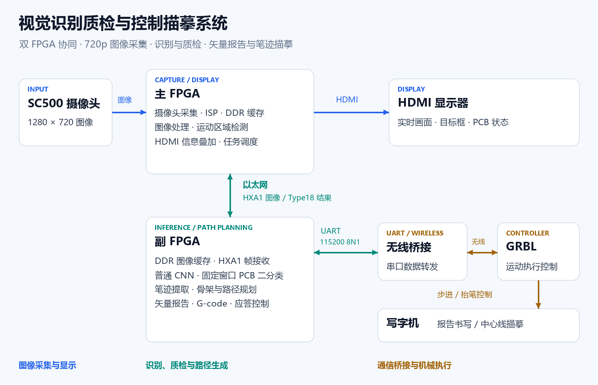
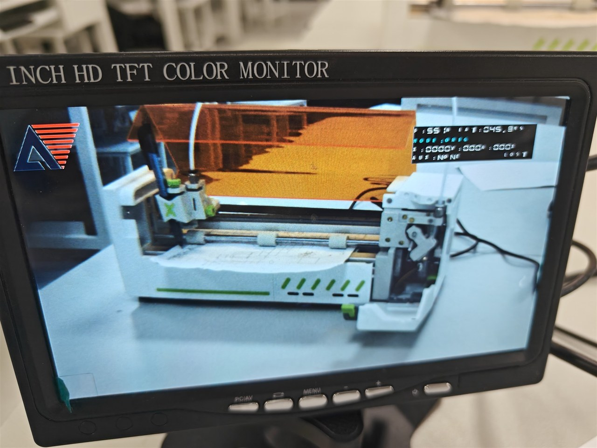
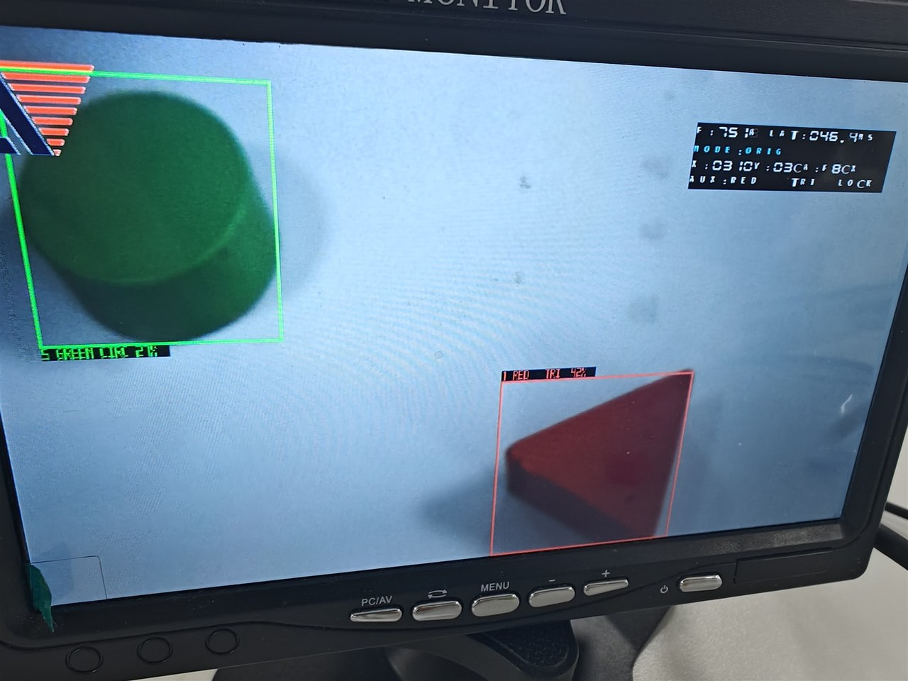
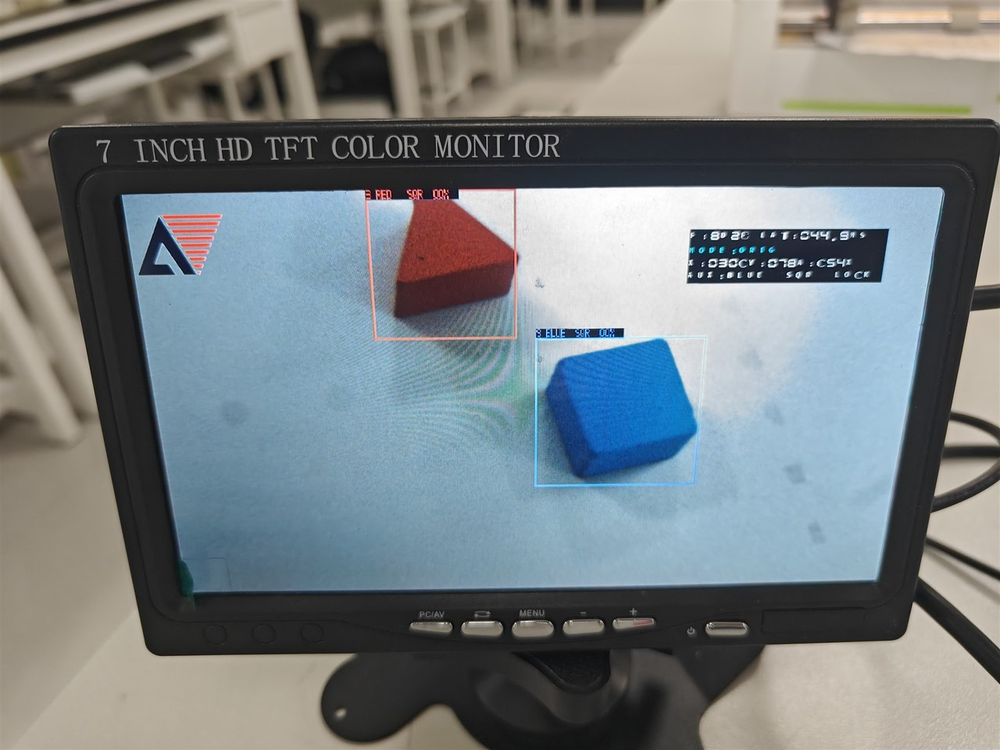
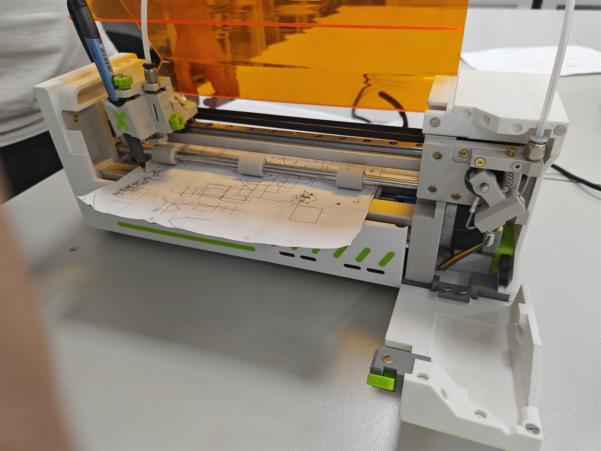

# 视觉识别质检与控制描摹系统

**Vision Inspection, Control & Tracing System · Dual-FPGA · FPGA 创新设计大赛参赛工程**

本作品基于 HX1P35A 平台，采用主从双 FPGA 与串口无线桥接协同架构，集成高清图像采集、视觉识别、PCB 质检和写字机控制，实现从图像感知、结果判定到报告书写与笔迹描摹的完整流程。

主板负责 SC500 摄像头 1280×720 图像采集、图像处理、运动区域检测和 HDMI 信息叠加，并调度板间图像与识别结果传输；副板通过以太网接收图像，完成轻量化 CNN 目标识别、固定窗口 PCB 二分类和文档笔迹提取，再将识别结果或笔迹转换为写字机路径；无线桥接模块负责转发副板与执行控制器之间的串口数据。

系统既能显示并书写目标名称、中心坐标和置信分数，输出 PCB 检测报告，也能将普通黑笔手写内容提取为中心线路径，按比例驱动写字机描摹，无需 OCR 或纸张四角定位。报告采用单线矢量字体，支持坐标镜像与自动换行；通过逐行应答、任务锁存和停止恢复机制，衔接视觉处理与 GRBL 运动控制，并在板间网络断开后保持已接受的写字任务。

## 系统结构

[查看 SVG 矢量图](docs/assets/system-architecture.svg)

## 实拍展示

| HDMI 图像采集与显示 | 多目标识别与信息叠加 |
| --- | --- |
|  |  |
| **不同物块识别** | **写字机执行平台** |
|  |  |

照片取自项目开发阶段的实拍记录，画面中的 OSD 为当时版本。更多图像处理效果及文档路径回放见 [演示图集](docs/GALLERY.md)。

## 主要功能

| 功能 | 当前版本行为 |
| --- | --- |
| 普通目标识别 | 9 类 CNN；输出名称、图像中心坐标和置信分数；连续确认与短暂不确定保持，允许输出真实低分结果 |
| PCB 检测 | 固定检测窗口、96×96 Y8、4→4 轻量二分类；输出 PASS / FAIL / REVIEW；主板 KEY4 每次按下触发一次，画面左下角显示状态 |
| 文档复制 | 整帧按比例映射，320×180 网格，每格读取 4×4 源像素；骨架、路径规划、机器坐标和 G-code；不做 OCR，不要求纸张四角或距离标定 |
| 笔迹路径 | 端点优先和分叉拆笔；针对固定机位右侧摄像头脏斑做局部补偿，保留路径容量与边界检查 |
| 写字报告 | 单线中心线矢量字体、一次 X 镜像、报告自动换行；PCB 二分类报告按文字实际高度换行 |
| 本地操作 | 副板 KEY1 提交识别结果报告、KEY2 一次方框测试、KEY3 整体应用复位、KEY4 写字任务停止与重置 |
| 任务保持 | 以太网断链不取消已接受的写字任务；串口错误单独处理，已发送运动命令不盲目重放 |
| 主板显示 | 中文信息叠加、PCB 常驻摆放框和左下状态、运动区域与变化采样点数显示、亮度调整 |

CNN 分数是模型输出经缩放得到的 margin，**不是校准后的正确概率**。描摹路径是几何中心线，不等于汉字标准笔顺。镜头脏斑补偿与当前机位和裁剪有关。

## 模式与操作

主板通过 SW4:SW3 选择任务模式，板间识别需选择向副板传图的通路。两板同名按键功能不同，完整接线与操作见 [硬件与控制](docs/HARDWARE_AND_CONTROL.md)。

| SW4:SW3 | 模式 | 主要操作 |
| --- | --- | --- |
| 00 | 普通 CNN | 显示目标名称、中心坐标与分数；副板 KEY1 锁存结果并书写报告 |
| 01 | PCB 二分类 | 常态显示摆放框；主板 KEY4 按下并消抖后启动一次识别，长按不连拍，松开不取消已接受任务 |
| 10 | 文档复制 | 按整帧比例提取笔迹并生成中心线路径，不依赖纸张四角定位 |
| 11 | 保留 | 暂无功能 |

PCB 框是固定采样区域的摆放参考，不表示缺陷位置。文档使用 A4 纸面坐标和安全边界，与相机测距是两项不同功能。运动数值表示所选运动区域内的变化采样点数，不是累计物体数量。与旧版介绍的具体差异及 RTL 依据见 [当前版本功能范围](docs/VERSION_SCOPE.md)。

## 工程入口

| 板卡 | 工程入口 |
| --- | --- |
| 主板 | [camera_to_dsi_display_720p60_cnn_multibox.al](hardware/main_osd_brightness_20261101/camera_to_dsi_display_720p60_cnn_multibox.al) |
| 副板 | [secondary_cnn_multibox.al](hardware/secondary_doc_dirt_lowconf_factored_20261101/secondary_cnn_multibox.al) |

两板器件均为 PH1P35MDG324、speed -3；工具记录为 Tang Dynasty **Release 2026.1 SP2 / 6.2.200067**。

~~~text
hardware/                     双板源工程与构建记录
  main_osd_brightness_20261101/ 主板 RTL、IP、模型、约束、bit、证据
  secondary_doc_dirt_lowconf_factored_20261101/
                                副板 RTL、IP、模型、约束、bit、证据
  PACKAGE_MANIFEST.json        源文件清单
  SHA256SUMS.txt               文件校验清单
docs/                         参赛说明、硬件接口、构建和验收状态
release/                      版本说明、bit 校验值与验收记录
verify_release.py             源文件与 bit 完整性校验
~~~

## 下载与校验

| 板卡 | 文件 |
| --- | --- |
| 主板 | [dual_fpga_main_20261101_osd_brightness_diagnostic.bit](hardware/main_osd_brightness_20261101/artifacts/dual_fpga_main_20261101_osd_brightness_diagnostic.bit) |
| 副板 | [dual_fpga_secondary_20261101_doc_dirt_lowconf_factored_diagnostic.bit](hardware/secondary_doc_dirt_lowconf_factored_20261101/artifacts/dual_fpga_secondary_20261101_doc_dirt_lowconf_factored_diagnostic.bit) |

~~~text
主板 SHA256
FB3FE4F57721C7068821EC0C010D589CB82398E6F38CCCF3F7892006033E5515

副板 SHA256
5066DC18572D27361957A63C1702EA3CD060CAEDAB88A0172F8A3C86451C1F34
~~~

下载后先运行：

~~~powershell
python -B verify_release.py
~~~

校验不需要 FPGA 工具。建议使用 **Python 3.11+**，下载完整仓库到短英文路径。构建流程见 [构建与核验](docs/BUILD_AND_VERIFY.md)；接线和按键见 [硬件与控制](docs/HARDWARE_AND_CONTROL.md)。

## 资源与时序

| 板卡 | Setup WNS | Hold WNS | TNS | Slice | ERAM | DSP |
| --- | --- | --- | --- | --- | --- | --- |
| 主板实际布线报告 | +0.384 ns | +0.020 ns | 0 | 92.73% | 83.33% | 92.50% |
| 副板最终发布报告 | +0.005 ns | +0.020 ns | 0 | 91.70% | 84.26% | 45.00% |

主板包含本版综合、布线和 bitgen 日志，部分源快照及专项检查沿用前版记录；副板包含完整发布检查记录。构建记录与实板测试情况见 [验证记录](docs/VALIDATION.md)。

主板亮度曲线同时作用于传给副板的图像，调整亮度时需同步检查识别效果。

## 版权与使用

仓库包含自主实现的 RTL、厂商 IP 和第三方模块，各文件遵循原有版权与许可条款，见 [第三方声明](docs/THIRD_PARTY_NOTICES.md)。ESP32 桥接固件需另行配置。
