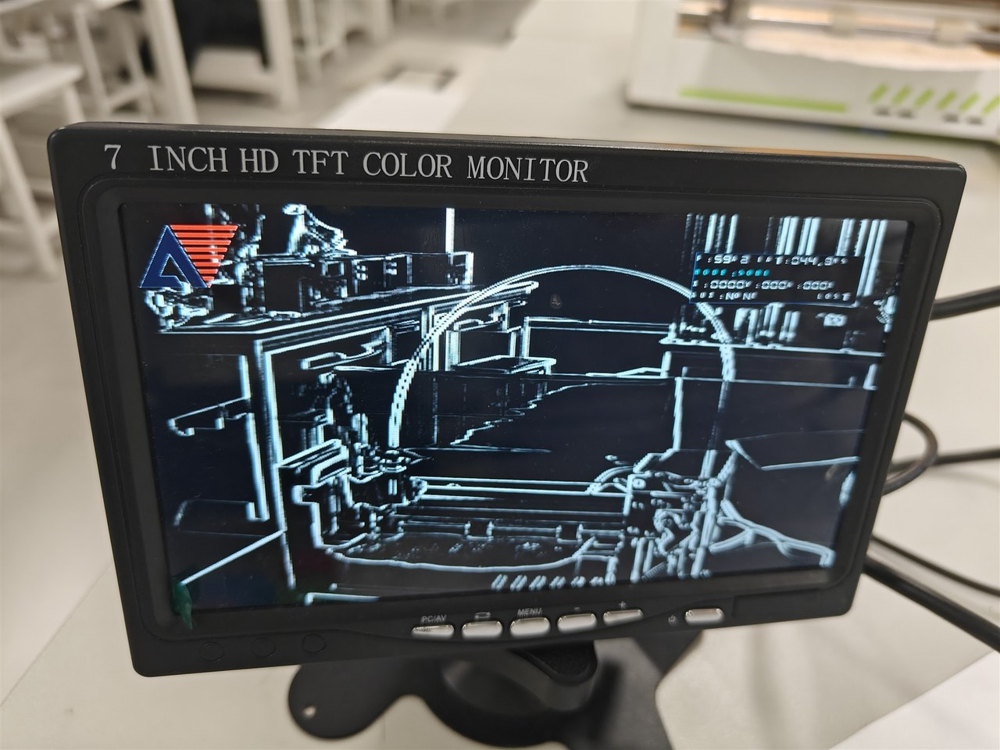
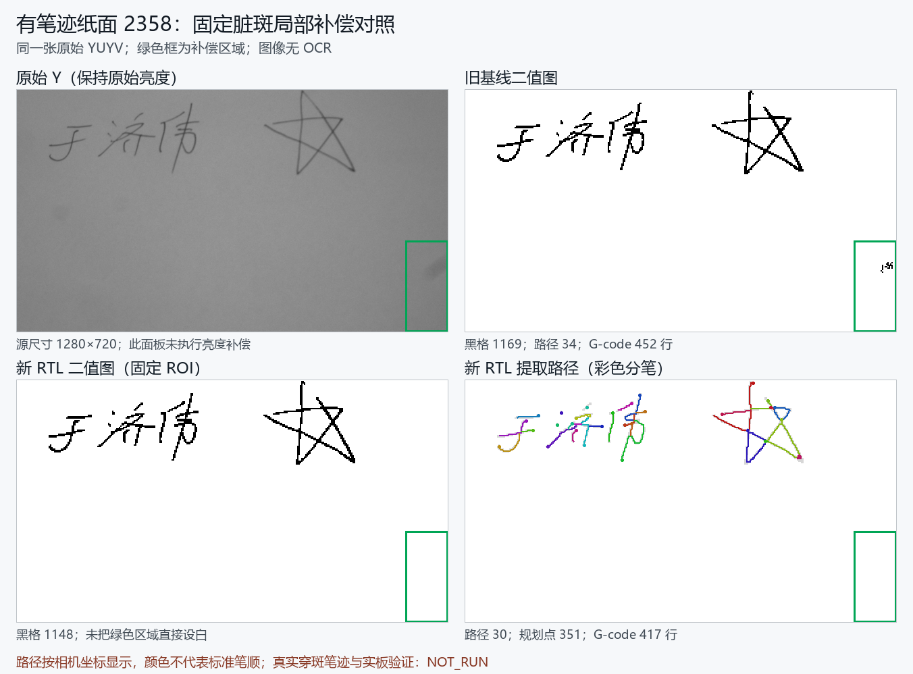

# 演示图集

## 系统架构

主板完成图像采集、显示和任务调度；副板完成 CNN / PCB 识别及文档路径规划；写字命令经串口无线桥接转发到 GRBL 控制器。

[SVG 矢量图](assets/system-architecture.svg)可用于报告和答辩材料。绘图脚本为 [render_architecture.py](render_architecture.py)，依赖 Pillow；字体路径可通过 DIAGRAM_FONT 和 DIAGRAM_FONT_BOLD 配置。

## 实拍：图像采集与处理

| 摄像头画面 | 边缘提取效果 |
| --- | --- |
|  |  |

## 实拍：普通目标识别

| 圆柱与三角物块 | 红色与蓝色物块 |
| --- | --- |
|  |  |

这些照片记录了开发阶段的识别与显示效果，界面采用当时的 OSD 布局。当前版本的输出字段和按键操作见 [硬件与控制](HARDWARE_AND_CONTROL.md)。

## 实拍：写字机平台

写字机通过笔夹安装普通笔，接收 GRBL 运动指令完成纸面绘制。图中为开发阶段的调试纸张。

## 文档描摹：实拍输入与 RTL 回放

左上为相机采集的原始亮度图，其余面板为二值化及 RTL 路径回放。绿色框标出固定脏斑补偿区域，彩色线用于区分路径。这组回放得到 30 条路径、351 个规划点和 417 行 G-code；回放图不代表写字机实绘结果，图底状态保留生成时记录。

## 图片来源

实拍照片选自项目说明书《main (1).pdf》：HDMI 显示和写字机照片见第 13 页，边缘提取见第 15 页，物块识别见第 17 页。发布图片仅等比例缩小并压缩为 JPEG，未修改识别标签或绘制结果。

路径对照图来自当前副板工程的 factored_delivery_quality 报告；系统架构图按当前工程连接绘制。
