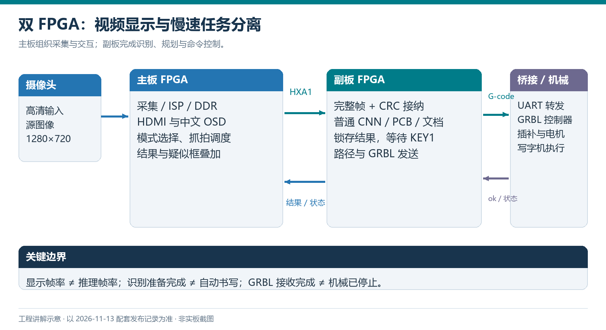
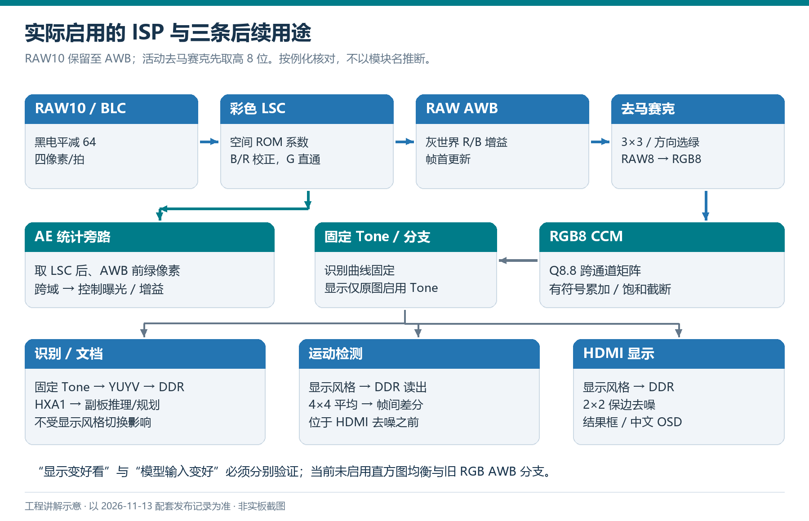
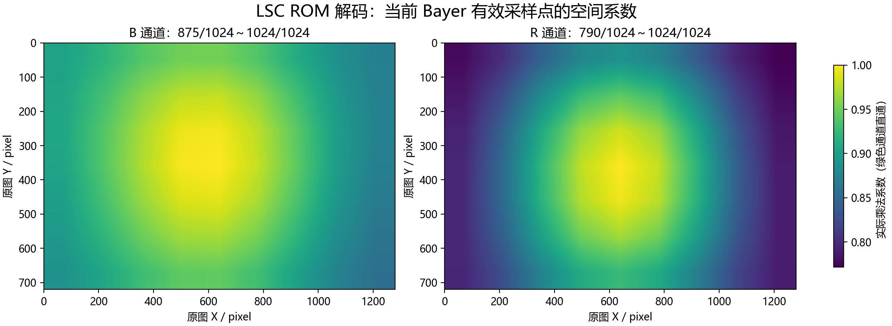
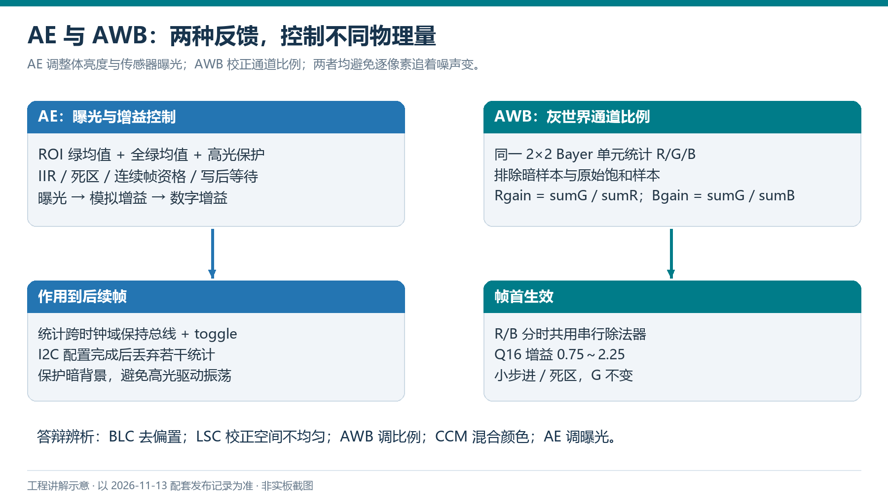
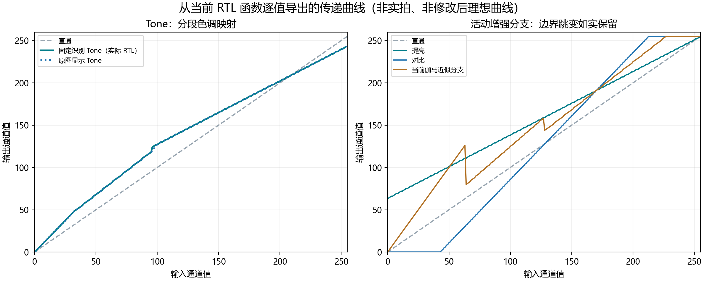
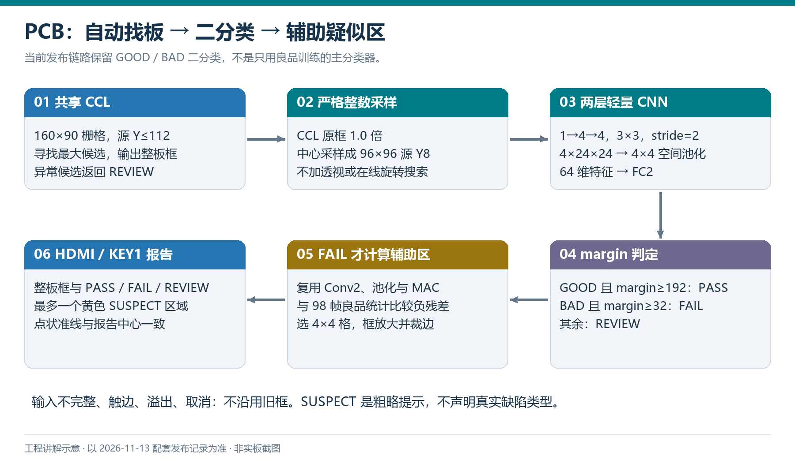
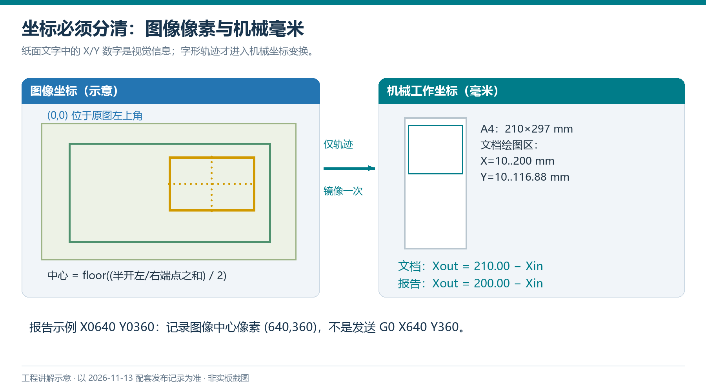
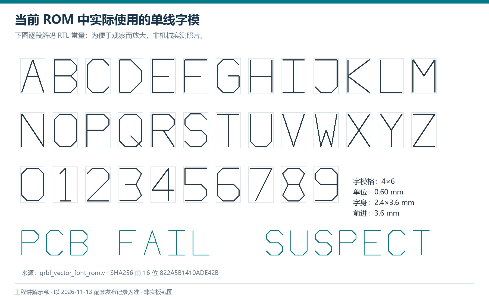
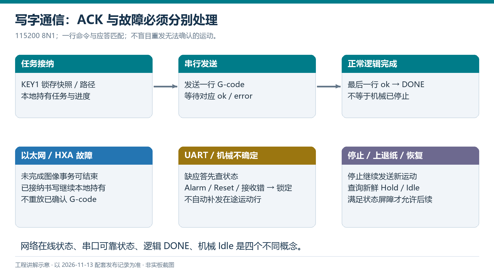
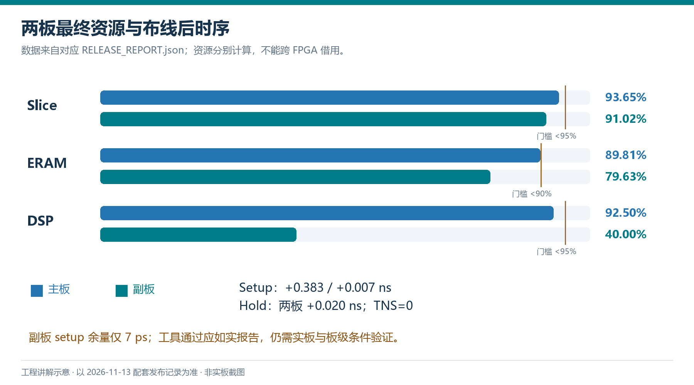

# 双 FPGA 视觉识别、PCB 辅助质检与写字控制系统

## 技术说明与答辩参考

文档版本：V1.1 算法详解版 · 2026 年 11 月 14 日

适用对象：2026-11-13 发布的主板疑似区域中心显示版与副板上纸、笔画连续化版。

用途：作品技术说明、答辩准备、演示说明与后续实板验收记录。

编写依据：已发布 bit 的构建报告、冻结输入、当前配套 RTL、模型契约和已保存仿真记录。本文不启动新训练或 FPGA 构建，不修改主、副板工程及 work/。

**版本状态：两板均已生成 diagnostic bit；本配套版本的实板验收状态仍为 NOT_RUN。**

<!-- PAGEBREAK -->

# 阅读导航与关键结论

本作品把“采集与显示—目标识别—PCB 辅助质检—人工确认—纸面报告/文档书写”连接成一个硬件处理系统。主板承担视频前端、显示与任务调度；副板承担完整帧接收、识别、路径生成和写字协议控制；外部串口/无线桥接模块及 GRBL 控制器承担指令转发和机械执行。

答辩时建议先说明整体流程，再展示一个普通目标和一块 PCB 的完整处理过程，最后用资源、时序和验证证据解释 FPGA 实现难点。可以重点阅读第 1、7、9、10、14、16 章；第 5 章详细讲解 ISP、19 种风格及运动；第 18 章提供现场演示步骤，第 19 章提供 32 个问答，附录 D 提供全系统算法速查。

| 关键结论 | 当前版本的准确表述 |
| --- | --- |
| 普通识别 | 颜色与形状分解，形成 9 个组合类别；支持多候选显示与类别稳定 |
| PCB 检测 | 共享 CCL 自动找板，96×96 灰度二分类，输出 PASS / FAIL / REVIEW |
| 疑似区域 | 仅对满足条件的 FAIL 给出一个大致 SUSPECT 区域；不是精确缺陷定位 |
| 写字触发 | 检测/规划完成后等待副板 KEY1，不立即自动书写 |
| 文档复制 | 图像二值化、骨架提取、路径组织、坐标转换后写字；不识别汉字语义 |
| 主板新改动 | 黄色疑似框内增加点状中心准线，并压缩显示逻辑 |
| 写字状态 | 按需显示中文操作状态；当前没有 HDMI 数值进度或机械完成百分比 |
| 发布验证 | 两板完成综合、布局、布线、最终时序和发布审计；不等于实板验收 |

**三句必须记住的话：**第一，分类结果与疑似区域是两个不同输出。第二，GRBL 的 ok 表示命令已接收，不表示机械运动已经完成。第三，布线时序通过和算法历史回放通过，都不能代替新版本的实板验证。

证据引用使用 [Rxx] 表示报告、[Sxx] 表示源码、[Mxx] 表示模型；完整路径、文件哈希和定位行号见附录及 EVIDENCE_INDEX.json。

<!-- TOC -->

<!-- PAGEBREAK -->

# 1. 作品定位与需求

## 1.1 应用目标

作品面向固定摄像头下的桌面视觉交互与小型 PCB 工件辅助检测。系统既能实时显示视频和处理效果，也能将识别或检测结果转换为可读纸面报告；在文档复制模式下，还能把摄像头中的笔迹转换为写字机运动路径。

与只显示分类名称的演示相比，本系统更强调结果如何进入后续操作：检测结果必须关联当前任务，显示与待写缓存必须一致，用户确认后才允许机械动作，异常时不能盲目重发命令。

## 1.2 主要设计要求

| 要求 | 对实现的影响 |
| --- | --- |
| 高清视频实时显示 | 采集、处理、缓存和 HDMI 时序必须连续，不能被慢速写字阻塞 |
| 普通目标与 PCB 共存 | 输入规则不同，使用统一调度和明确的数据通路所有权 |
| PCB 能随位置变化找板 | 使用 CCL 自动候选框，避免只检测固定屏幕窗口 |
| 写字需要人工确认 | 图像任务与运动任务分开接纳，KEY1 消费锁存快照 |
| 断网不破坏已接纳任务 | 写字进度由副板本地持有，不依赖持续在线的网络会话 |
| 不允许无界资源增长 | 串行 MAC、共享 RAM、同步 ROM、有限路径容量及越界拒绝 |
| 纸张与机械状态可控 | 自动换行、纸面预算、上退纸维护、新鲜状态屏障 |

## 1.3 本文版本范围

本文固定说明主板 bit E2E1FE98…08011 和副板 bit 5BA649F3…D5B8EE5。后续主对话中的新定位优化、训练、候选 RTL 或新 bit 均不自动纳入本文。文件名中遗留的 pose7、goodonly、candidate 等字样不作为是否启用某功能的证据；实际例化参数、活动依赖和发布报告优先。[R01][R02][S01][S02]

<!-- PAGEBREAK -->

# 2. 总体架构与板间分工



## 2.1 主板：让视频连续、让操作可见

主板完成摄像头视频接入、ISP 与显示风格处理、DDR 视频缓存及 HDMI 叠加。识别用快照和显示用风格图像在系统中具有明确的分流点，不能把显示端的后级滤波误认为同步修改了 CNN 输入。主板还负责模式选择、图像任务请求、PCB 按键触发以及副板结果的接收显示。[S01]

## 2.2 副板：让完整帧变成识别结果或运动任务

副板接收带会话和帧标识的图像包，写入 DDR 并验证完整性；普通 CNN、PCB 和文档复制按任务分时使用读取器及中间存储。结果先进入显示/待写快照；只有满足当前模式、纸面、UART 和互斥条件时，KEY1 才能接纳书写。

普通 CNN 与 PCB 共享 CCL 和部分算术、workspace 资源，但二者的输入预处理、模型和结果含义并不相同。文档与报告也保留独立的内容生成器，同时共享物理命令格式化、应答解析及 UART 传输通路。[S02][S03][S11]

## 2.3 外部控制器：执行运动而非替代视觉计算

FPGA 端发送 GRBL 兼容的 ASCII G-code 和实时控制字节。若实物使用 ESP32 或无线桥，桥接部分负责转发；插补、步进脉冲和电机执行由外部运动控制器完成。本文依据 FPGA 侧 UART 和 GRBL 接口说明，不推定桥接固件的无线协议、缓存或可靠性实现。

答辩表述：本作品实现的是 FPGA 视觉与运动任务控制，不能把 GRBL 内部插补算法也算成自己在 FPGA 中实现的功能。

<!-- PAGEBREAK -->

# 3. 硬件、时钟与数据组织

## 3.1 已核对的工程参数

| 项目 | 当前记录 |
| --- | --- |
| 工具报告中的器件 | PH1P35MDG324；实物商品型号以开发板资料和丝印核对 |
| 每板资源总量 | 21,216 Slice、108 ERAM、40 DSP |
| 视频有效尺寸 | 1280×720；主板工程目标为 720p60 |
| 系统外部参考 | 副板 50 MHz，内部主要视觉/链路逻辑为 125 MHz |
| 图像存储格式 | YUYV，每像素平均 2 字节 |
| 副板 DDR 应用数据宽度 | 128 bit，即每次 16 字节 |
| CCL 检测栅格 | 160×90，对应原图每 8 像素一个采样单元 |
| 普通 CNN 输入 | 64×64 RGB8，内部形状路径与颜色统计分离 |
| PCB CNN 输入 | 96×96 原始源 Y8 灰度 |
| 写字串口 | 115200 bit/s、8 数据位、无校验、1 停止位，空闲高电平 |

50 MHz、125 MHz、DDR 用户时钟、摄像头时钟和 HDMI 像素时钟不是同一个域。系统使用同步器、握手、异步 FIFO 等既有机制跨域；多位元数据以稳定快照/邮箱方式传递，不能把每一位各加两级触发器就视为一致传输。[S01][S02][S12]

## 3.2 为什么显示帧率不等于推理帧率

一张 1280×720 YUYV 图像约为 1,843,200 字节，即约 1.76 MiB。如果连续传输 60 张完整图像，每秒仅有效像素就需 110.592 MB，约 884.736 Mbit，还没有计入协议和调度开销。因此系统显示链路与板间推理任务链路采用不同节奏是合理的。

这里的带宽数值是根据格式计算的理论数据量，不是本版实测吞吐率。当前报告没有给出一套覆盖传图、CRC、候选搜索、推理及结果返回的完整端到端时延测量，不应在答辩中承诺“每秒 60 次 PCB 检测”。

## 3.3 帧数据为什么要锁定

DMA/DDR 请求发出后，即使上层取消了图像任务，底层仍可能返回此前请求的数据。必须等待已接纳读事务排空后再释放所有权；否则迟到数据可能被下一任务误用。当前 PCB 包装器有 read_pending、DRAIN 和 LOCKED 路径，不能只把 busy 清零来处理取消。[S04]

<!-- PAGEBREAK -->

# 4. 模式、按键与用户操作

## 4.1 主板操作

| 操作 | 当前功能 |
| --- | --- |
| SW4:SW3=00 | 普通 CNN 模式 |
| SW4:SW3=01 | PCB 模式 |
| SW4:SW3=10 | 文档复制模式 |
| SW4:SW3=11 | 不在本文主要演示流程中，不推定为上述三种模式之一 |
| KEY2（A9） | 切换视频显示风格 |
| KEY3（B9） | 恢复显示风格选择，不是复位副板或重新录入良品模板 |
| KEY4（C7） | PCB 模式下每次稳定按压授权一次抓拍/检测；持续按住不会无限触发 |
| SW1 | 控制运动检测叠加显示 |

主板 KEY4 的“按住检测”在当前实现中采用去抖后单次触发：需要释放再按才能开始下一次。不能沿用早期版本“按住期间不断推理”的说明。主板 KEY1 不作为本文配套系统的本地书写确认入口。[S01]

## 4.2 副板操作

| 操作 | 当前功能与限制 |
| --- | --- |
| KEY1（D5）短按 | CNN 模式写 CNN 快照；PCB 模式写 PCB 报告；文档模式消费已准备路径 |
| KEY1 长按 | 仅在上纸待确认状态执行上纸确认；不再作为普通任务整段干跑 |
| KEY2（A9）短按 | 松开后画一个固定正方形，换行，执行既有 X0 / G92 规则 |
| KEY2 长按至少 2 秒 | 请求一次退纸；释放不会补画一个方框 |
| KEY3（B9） | 整个副板应用复位，包括相关初始化与串口启动恢复 |
| KEY4（C7） | 当前写字/文档任务停止与复位入口；不等同于整个副板复位 |

忙碌或不安全时按下的 KEY2 不应排队到稍后突然执行；上电/复位时一直按住的按键不能直接成为新任务。按键行为以去抖后的任务接纳事件为准，而不是直接使用引脚电平驱动运动。[R02][S02]

<!-- PAGEBREAK -->

# 5. 主板 ISP、显示风格、运动检测与 OSD

本章按当前配套 bit 的实际模块例化讲解。每个算法先说明解决的问题，再给出当前公式、定点实现和限制。源码目录里存在但未接入活动链的模块另列，不把历史试验当成发布功能。[S01][S23]

## 5.1 从 RAW10 到显示与识别的完整链路



摄像头通过 MIPI/CSI 送出 BGGR RAW10。RAW 图的每个位置只有 R、G、B 中一个真实测量值，不能直接当作 RGB 三通道图像。当前每拍装四个 10 bit 像素，共 40 bit；完成颜色重建后，每拍四个 RGB888 像素，共 96 bit。部分总线按四个 32 bit 槽组织成 128 bit，其中包含填充位。

活动处理顺序是 BLC→彩色 LSC→RAW 灰世界 AWB→去马赛克→RGB8 CCM→Tone/风格分支。AE 在 LSC 后、AWB 前旁路统计真实绿样本，统计器不改写像素。识别快照采用固定 Tone 输出；显示路径只有“原图”模式启用显示 Tone，其余风格取 CCM 后的 RGB。运动从 DDR 读出的显示风格数据取样，HDMI 末级去噪再叠加 OSD。[S01][S23]

| 处理位置 | 活动数据格式 | 主要功能 | 当前状态 |
| --- | --- | --- | --- |
| BLC、LSC、AWB | RAW10 BGGR，40 bit/拍 | 去黑电平、空间颜色补偿、通道平衡 | 已启用 |
| AE 旁路 | RAW10 的绿样本统计 | 曝光及增益闭环 | 已启用 |
| 活动去马赛克 | 先 RAW10→RAW8，再生成 RGB8 | 邻域补齐缺失颜色 | 已启用 |
| CCM、Tone、风格 | RGB888，96 bit/拍 | 颜色校正、色调及显示效果 | 已启用 |
| HDMI 空间去噪 | 单像素 RGB888 | 2×2 因果保边平均 | 已启用，仅影响显示 |
| 旧 RGB AWB、denoise_96 等 | 源码中保留的其它路径 | 备选实现 | 不在当前活动链 |

“原图”是显示模式名称，不表示未经 ISP 的传感器原始值。切换显示风格不应改变固定识别快照曲线；但当前运动路径会受到显示风格影响，因此不同风格的运动检测效果需分别评价。

## 5.2 Bayer 相位、帧标记与弹性流水

BGGR 的一个 2×2 单元为第一行 B/Gr、第二行 Gb/R。偶数行四像素是 B/Gr/B/Gr，奇数行是 Gb/R/Gb/R；Gr 与 Gb 都是真实绿样本。颜色由空间相位确定，不能在 RAW 数据中按数值大小猜颜色。

流水使用 ready/valid 传输约定：只有 valid 与 ready 同时有效才接受一拍。阻塞时像素、SOF、EOL 必须一起保持；不能数据停住而行列计数继续前进。SOF 用于重建帧坐标、Bayer 相位及按帧配置；EOL 检查行宽。连续流水追求吞吐率，延迟若干拍并不等于吞吐率下降。[S24][S25]

典型一级弹性寄存器的可接收条件是“当前没有有效输出，或下游本拍可以接收”。本系统不能把所有 valid 信号直接等同于时钟使能；行缓存、标记和统计都必须按实际接受事件更新。

## 5.3 BLC：黑电平校正

BLC（Black Level Correction）去除传感器暗电流、读出电路和数字偏置形成的基线。暗场的原始值往往不是零；若直接做 AWB 增益，偏置也被放大，暗部容易发灰或偏色。

```text
P_blc = max(P_raw - OFFSET_color, 0)
OFFSET_B = OFFSET_Gr = OFFSET_Gb = OFFSET_R = 64
```

当前四通道都减 64，负值钳零，输出仍为 10 bit。例如 40→0、64→0、100→36、1023→959。硬件为四路比较/减法及一拍弹性寄存器，不需要整帧存储。行奇偶只随接纳像素更新，SOF 重新建立相位。[S24]

这属于固定黑电平补偿，当前没有在线遮光像素测量或温度自校准证据。答辩可表述为“在 RAW 域先消除固定偏置，改善后续增益校正的基准”，不应称为能自动消除所有暗噪声。

## 5.4 LSC：空间颜色均匀化与低秩系数场

LSC（Lens Shading Correction）一般用于补偿镜头、传感器及照明造成的空间亮度/颜色不均匀。通用方法是让每个位置采用不同系数；本版本具体采用冻结的 R/B 色场低秩近似，绿色直通。

```text
C_q4(x,y) = Xbase_q4(x) + Ybase_q4(y)
             + round(Xcross_q14(x) * Ycross_q8(y) / 2^18)
K(x,y) = clip(round(C_q4 / 16), 0, 1024)
P_lsc = clip10((P_blc * K + 512) >> 10)
```

原始冻结色场为 9×7 单元中心参考，在线采用“两个一维基线＋一个可分离交叉项”近似，不存整幅 1280×720 的独立系数，也不为每个像素做四邻点二维除法插值。横向 ROM 为 4096×32 bit，B/R 每色补齐到 2048 地址；纵向 ROM 为 1024×32 bit，根据绝对行号存当前 Bayer 行的 B 或 R 数据。[S25][M04]

每个 ROM 字的高 16 bit 是有符号基线；横向低 16 bit 为 Q14 交叉因子，纵向低 16 bit 为 DN Q8 因子。交叉乘积加 131072 后右移 18 转 Q4，基线相加后加 8、右移 4 得系数整数。两个彩色像素通道采用同步 ROM、系数乘加、像素乘法的三级弹性流水。这里的 Q 格式必须按实际字段解释，不能把所有 16 bit 字段都叫 Q8.8。



文档逐点解码得到：B 有效位置系数范围 875/1024～1024/1024，R 为 790/1024～1024/1024，两色各检查 230,400 个 Bayer 有效点。因此当前是系数不超过 1 的空间衰减式色彩均匀化；不能宣传为“角落自动乘大于 1 的增益、自动提亮暗角”。图中只画冻结表的计算结果，不是实拍改善效果。[R12]

为保护 AWB，在 LSC 衰减之前记录 BLC 后像素≥936 的原始饱和标记，等价于减 64 前≥1000。否则已经饱和的样本经 LSC 变暗后可能被错误纳入白平衡统计。尺寸/行尾异常后该帧剩余处理绕过 LSC，避免继续使用错位的空间系数；已输出的像素不回溯修改。[S25]

## 5.5 AE：RAW 域曝光统计

AE（Auto Exposure）先测光，再反馈调曝光/增益。当前不是简单对 HDMI 全屏求平均，也不是标准 PID。统计窗口为原图半开区间 X=[160,1120)、Y=[90,630)，即中央 960×540 区域。每个四像素拍只取两个真实绿样本，避免把插值色或 AWB 增益带入测光。[S26]

```text
ROI 外权重 = 0
ROI 内：G<24 权重0；24≤G<48 权重1；G≥48 权重2
Y_meter = floor((sum(w*G) / sum(w)) / 4)
Y_all   = ROI 全部绿样本均值 / 4（含暗样本）
Highlight_guard = max(Hard_clip_percent, min(Bright_tail_percent, 8))
Hard_clip：G≥944；Bright_tail：G≥860
```

加权测光让极暗噪声少影响目标亮度，同时保留全绿均值，防止只剩少量亮点参与统计而把整幅背景压黑。高光保护量综合硬高光及受限亮尾，不是纯粹的“饱和像素比例”。百分比都在同一 ROI 内统计。

逐像素只做比较与累加，帧后复用串行除法计算均值和比例，不把大除法器插入每拍像素关键路径。完整且尺寸合法的帧才发布统计；统计总线保持稳定，利用 toggle 及同步电路跨到控制时钟域。

## 5.6 AE：曝光、模拟增益、数字增益与稳定策略



| 参数 | 当前配置 | 含义 |
| --- | --- | --- |
| 目标与死区 | 目标128，死区124..136 | 避免亮度在目标附近频繁往返 |
| 控制时钟 | 24 MHz | 用于曝光控制状态机，不是像素亮度单位 |
| 曝光码 | 最小3、运动上限1990；初值1990 | 单位为传感器半行曝光码，不能写成毫秒 |
| 模拟增益码 | 16..143，步长3；初值80 | 寄存器码，不直接等于倍数 |
| 数字增益 | Q7，128..256，步长4 | 128表示1倍，256表示2倍 |
| 普通高光锁定 | 进入5%、退出3% | 进入需3个合格统计，退出需6个 |
| 强高光 | 16% | 优先较大幅度降曝光 |
| 暗背景保护 | 48/64，配合恢复等待 | 不让少量强光持续压黑背景 |
| 曝光量化步 | FLICKER_N=60 | 当前为60个曝光码步进，不承诺严格工频周期 |

亮度采用约 1/8 差值的 IIR 平滑，小差至少移动一个码值；死区内通常保持。增亮优先提高曝光，再模拟增益，到边界才提高数字增益；变暗方向相应优先减曝光，再减增益。强高光可优先将曝光降低约 1/8。[S27][S01]

更新传感器配置后，先丢弃三个统计事件，第四个重建滤波值，避免把尚未生效的旧帧当成新设置的反馈。暗亮混合保护、连续帧资格、单参数试探及必要回退用于减少震荡。一次只改变受控参数，配合写完成握手；这比“每帧看到暗就同时增大曝光和增益”更容易控制。

曝光时间越长，运动模糊越大；模拟增益提高噪声，数字增益也不能恢复已经丢失的信号。因此 AE 是亮度、噪声和运动清晰度的折中。当前未提供传感器完整行时序换算和光源频率实测，不应把 60 曝光码直接解释为 60 行或已经验证的 50/60 Hz 抗闪烁。

## 5.7 AWB：RAW 灰世界白平衡

AWB（Auto White Balance）调整 R/B 与 G 的相对增益，减少光源色温导致的整体偏色。灰世界假设场景整体的平均颜色近似中性，因此可以以 G 为参考：

```text
G_block = floor((Gr + Gb) / 2)
gain_R_q16 = (sumG << 16) / sumR
gain_B_q16 = (sumG << 16) / sumB
R_out = clip10((R_in * gain_R_q16 + 32768) >> 16)
B_out = clip10((B_in * gain_B_q16 + 32768) >> 16)
G_out = G_in
```

当前在对应 2×2 Bayer 单元组合 R、两绿均值与 B；每八个四像素拍采一个统计位置，水平约每 32 像素取样。暗块要求 G_block≥32，并排除任何带原始饱和标记的单元；至少 128 个有效块才允许有效更新，最多统计 28,800 块。没有中性色/色度筛选门，因此不能说它“只对白纸灰点估计光源”。[S28]

统计累加为 25 bit，带 16 个小数位的除法分子为 41 bit。R/B 分时共用串行恢复除法器，不需要每个像素一个除法。增益采用 20 bit，1倍=0x10000；范围 0x0C000..0x24000，即 0.75..2.25。死区为 0x100（1/256），步长为 0x200（1/128），小步逼近目标；新增益在帧首统一生效，防止同一帧上下色温不同。

例如 sumG 比 sumR 大约20%，则目标 Rgain 约1.2倍，但实际分多次小步更新。大面积单一红、绿或蓝物体会破坏灰世界假设；有效统计不足时保持旧增益并不等于识别出了正确物体颜色。AWB 目标是光照通道平衡，物体颜色分类在副板另做。

## 5.8 去马赛克：双线性底座与方向选绿

去马赛克为每个 Bayer 位置补齐缺失的另外两种颜色。活动实现先取 RAW10 的 [9:2] 高 8 bit，再构建 3×3 窗口；不是全程 10 bit 插值。四像素并行采用行缓存与邻列寄存器，不需要为整个视频存一个卷积帧。[S29]

基本两点均值用 (a+b+1)>>1，四点均值用 (a+b+c+d+2)>>2。在 R/B 点补 G 时比较水平、垂直方向差异：

```text
dh = abs(G_left - G_right)
dv = abs(G_up - G_down)
G_missing = (dh≤dv) ? round((G_left+G_right)/2)
                     : round((G_up+G_down)/2)
```

较平滑方向优先，平局取水平，可减少跨越明显边缘的混色；R/B 的其它缺失值沿相应邻居做双线性重建。因此准确名称是“双线性插值基础上的绿色方向选择”，不能因文件名含 bilinear 就略去方向逻辑，也不能把未启用的 demosaic10_edge 描述成当前全精度算法。

算法仍可能出现细纹伪色、锯齿和边界插值误差；后续 CCM 不能恢复 RAW 低两位，也不能还原已经混叠掉的纹理。

## 5.9 CCM：颜色校正矩阵

CCM（Color Correction Matrix）用跨通道线性变换修正传感器响应与目标显示颜色之间的差异。它与 AWB 不同：AWB 主要是 R/G/B 各自缩放，CCM 允许一个输出颜色由多个输入通道共同决定。当前位于去马赛克之后、Tone 之前。[S30]

```text
[R']   1   [ 261  -20   15 ] [R]
[G'] = --- [ -10  266    0 ] [G]，逐通道算术右移8后clip到0..255
[B']   256 [   5  -15  269 ] [B]
```

系数按 Q8.8 理解，约为 R'=1.0195R−0.0781G+0.0586B，G'=−0.0391R+1.0391G，B'=0.0195R−0.0586G+1.0508B。矩阵没有加 128 做最近舍入，当前使用有符号算术右移。中间约 18 bit 有符号累加，负数钳零，溢出钳255，不能直接截低8位产生环绕。

为降低乘法开销，RTL 使用等价分解：T=R−3G+B；Rnum=256R+5(T−G+2B)，Gnum=256G+10(G−R)，Bnum=264B+5T。常数乘用移位加法或 DSP，部分通道采用精确 LUT 加法，三级弹性流水保持四像素吞吐。共享表达式必须在溢出前保留足够位宽，才能与原矩阵逐值等价。

LSC 按位置变化，AWB 按通道比例变化，CCM 做通道混合，三者解决不同问题。当前没有色卡标定、标准光源或 ΔE 测量记录，因此只能说明实现了所示颜色矩阵，不能声称达到某项专业色差指标。

## 5.10 Tone：固定识别曲线与原图显示曲线

当前 Tone 是低成本分段色调映射，抬部分暗部并压缩亮端；不是全局直方图均衡，也不是精确的标准 sRGB Gamma。对每个 RGB 通道 x，固定识别曲线为 y=x+offset：

```text
x<32       ：offset = floor(x/2)
32≤x<96    ：offset = floor(x/8)+12
x≥96       ：offset = 52-floor(x/4)-b
b = 1，当x≥192且x mod 4=3；否则0
```

offset 用有符号 6 bit 表示，范围约 −12..28。全输入枚举显示固定输出为 0..243，单调不减。例如 0→0、31→46、32→48、95→118、255→243。原图显示支路把 96..99 改为 120/122/124/126，桥接相邻区间；固定识别支路保持原公式，相应输出为124/125/126/127。[S31][R12]



识别与显示分支采用同一事务标记但不同约定，保证显示模式切换不会任意改变模型输入。调整亮度或 Gamma 若发生在模型输入之前，可能改变训练分布，应重新整数回放，不能只凭屏幕“更亮”判断识别一定提升。

## 5.11 19 种显示风格：编号、运算与用途

这些风格由确定性像素/邻域算法实现，没有神经风格网络、生成模型或在线训练。下表按当前 OSD 的实际编号组织；对存在位级偏差的分支，第5.14节给出实际结果，不能只照通用公式宣传。[S32]

| 编号/名称 | 当前处理或目标 | 实现要点与解释 |
| --- | --- | --- |
| 0 原图 | 当前 ISP 颜色及原图 Tone | 是处理后原图，不是 RAW 直通 |
| 1 灰度 | (R>>2)+(G>>1)+(G>>4)+(B>>3) | 移位加法；最大236，非标准601权重 |
| 2 阈值 | gray≥128输出白，否则黑 | 固定阈值，不是 Otsu 自适应阈值 |
| 3 反色 | 每通道255−x | 8 bit 反相，显示负片效果 |
| 4 红色 | 只保留R，G/B清零 | 通道可视化，不是目标检测 |
| 5 量化 | 每通道 x AND 0xE0 | 每通道8级，RGB最多512种组合 |
| 6 饱和 | 意图放大通道相对gray的偏差 | 当前负差符号扩展有偏差，见5.14 |
| 7 边缘 | Sobel两方向绝对值之和 | 在四像素组栅格做空间运算 |
| 8 反边 | 255−边缘值 | 黑白关系反转 |
| 9 浮雕 | 定向邻域差×2＋128 | 有符号计算与8 bit钳位 |
| 10 彩虹 | 灰度分段伪彩 | 当前扩宽/截断需按活动RTL解释 |
| 11 腐蚀 | 3×3灰度邻域最小值 | 亮区域收缩，暗区域扩展 |
| 12 膨胀 | 3×3灰度邻域最大值 | 亮区域扩展，暗区域收缩 |
| 13 形态 | max9−min9 | 形态学梯度，不是开/闭运算 |
| 14 蓝色 | 只保留B，R/G清零 | 蓝通道可视化 |
| 15 提亮 | x+floor((255−x)/4) | 向白端压缩，不是加固定亮度 |
| 16 对比 | clip8(x+floor(x/2)−64) | 围绕128的约1.5倍对比 |
| 17 伽马 | 当前分段移位近似分支 | 边界非单调，不是标准幂函数Gamma |
| 18 卡通 | 因果边缘黑线＋RGB8级量化 | 独立逐像素卡通路径，见5.13 |

灰度式的各项在相加前分别截断，约为0.25R+0.5625G+0.125B；三个权重和小于1，白色255得到236。固定阈值128应按此实际量程理解。它与运动检测使用的 (77R+150G+29B)>>8、与板间 BT.601 limited Y 都不是同一种亮度值。

提亮示例：0→63、128→159、255→255。对比低端/高端需饱和，避免本应黑的负结果绕成白；量化示例255→224，会减颜色层次以形成色块，但不会凭空新增边缘信息。

## 5.12 Sobel、浮雕与形态学的空间实现

设窗口 p00..p22 按三行排列，p11 为中心。经典 Sobel 模板为：

```text
Gx = (-p00+p02) + 2*(-p10+p12) + (-p20+p22)
Gy = (-p00-2*p01-p02) + (p20+2*p21+p22)
Edge = clip8(abs(Gx)+abs(Gy))
Emboss = clip8(2*(p12+p21+2*p22-p01-p10-2*p00)+128)
Erode = min(p00..p22)
Dilate = max(p00..p22)
Morph_gradient = Dilate-Erode
```

绝对值相加近似梯度幅度，省掉平方与开方；核的整体符号反转不影响绝对幅值。浮雕则保留方向正负，以128为中性灰，形成定向明暗。灰度腐蚀/膨胀以“亮”为前景理解，与文档中“黑笔迹为1”的二值语义不能混用。

本版空间风格使用“四像素组平均灰度”的3×3窗口，横向一个采样单位相当于原图四像素，结果复制给该组四个像素。因此不是对每个原始像素做完整3×3 Sobel。两行组灰度打包在一个16 bit ERAM字，共320个组地址，并处理读写转发；空间运算按当前模式共享，避免同时生成全部核的宽结果。[S32]

窗口尚无效时，边缘/浮雕回退为0，腐蚀/膨胀回退当前组灰度，形态梯度为0。首行、首组及SOF处理不是装饰逻辑：忽略它们会把旧帧RAM内容变成伪边缘。风格配置在帧首锁存，流水标记必须与图像同延迟。

## 5.13 卡通化：因果梯度与色阶压缩

活动卡通模块 cartoon_96 逐像素保存左邻灰度及上行灰度，使用因果差分：

```text
E = abs(gray_current-gray_left) + abs(gray_current-gray_up)
若E超过当前边缘门限32：输出黑色边缘
否则：每个RGB通道 AND 0xE0，保留8级
```

它结合“边缘突出”和“颜色简化”获得卡通效果，不使用完整 Sobel 或双边滤波。单行缓存把四个上行灰度放到32 bit字，320个组地址；跨组传递左邻，首行/首列只量化，不访问上一帧的残留数据。输入输出有效像素一一对应，不通过额外补一行改变实时视频节奏。[S33][S23]

Sobel空间风格在组栅格上，卡通在逐像素因果邻域上，二者的分辨率与视觉效果不同。不能因卡通也有边缘，就把它写成与编号7相同的Sobel算法。

## 5.14 算术探针发现的当前实现偏差

为使答辩材料与 bit 对应，本次只在文档目录调用实际 RTL 组合函数：18个模式×263个输入=4,734组，另枚举256个Tone输入。编译和成功的批量仿真均0错误、0警告。空间功能输入固定为示意特征40，未验证空间窗口、卡通、帧节奏或实板画质；初次运行的本地RPC故障保留日志，批量重试成功。[R12]

| 分支 | 活动位级结果 | 答辩应怎样说明 |
| --- | --- | --- |
| 饱和6 | FF0000的gray=63，却输出FFFFFF | 负delta切片被零扩展，不能声称正确标准饱和增强 |
| 伽马17 | 63→126，64→80；127→158，128→144 | 活动分段曲线存在向下跳变，不是单调标准Gamma |
| 彩虹10 | 808080的gray=120，输出00001F | 某些拼接表达式含无位宽常数，扩宽再截断偏离理想伪彩 |
| 灰度1 | FFFFFF→ECECEC，即236 | 是省资源移位权重，不是精确BT.601灰度 |

活动伽马分支实际为 x<64时clip8(2x)，64≤x<128时clip8(x+floor(x/4))，x≥128时clip8(x+floor(x/8))。源码旁另有未被此分支调用的参考函数，不能将参考曲线误写为当前输出。

标准Gamma的一般形式是 y=255*(x/255)^(1/gamma)，常用LUT实现；这可以作为算法背景，但本 bit 不能用该理想曲线替代实际分段结果。本次只修订文档、生成核对证据，没有修RTL或重新生成bit。正式展示建议优先使用行为已确认的原图、灰度、边缘、形态和卡通等模式；后续修订应在独立工程做逐值和帧级回归。

## 5.15 HDMI：2×2 因果保边空间去噪

HDMI 后级对当前原始像素 C 与左邻原始像素 L 比较RGB三个通道，只有三个差值都≤16时才取四舍五入均值H，否则保留C。再对H与上行保存的H做同样比较，满足时取均值V，否则保留H：[S34]

```text
H(x,y) = close_rgb(C,L,16) ? round((C+L)/2) : C
V(x,y) = close_rgb(H,H_up,16) ? round((H+H_up)/2) : H
```

这样平坦区随机噪声可被减弱，大边缘尽量保留。行RAM存水平结果H，约1280×24 bit；不存最终V做递归，因而不是IIR图像平滑，也不是跨帧降噪。首行/首列、完整行有效掩码防止旧RAM污染，视频有效与同步标记同时延迟。

该模块位于显示DDR之后，只改善HDMI观感，不改变副板CNN/PCB输入。阈值过大会模糊笔画，过小则去噪有限；它也不是能自动去掉镜头固定污点的算法。传入核心的旧I_den_strength接口不等于旧denoise_96已启用。

## 5.16 RGB 转 YUYV：板间图像的实际数值契约

快照模块采用近似BT.601 limited转换，每两个像素共享一组U/V：[S35]

```text
Y = 16 + ((66R +129G +25B +128) >> 8)
U = 128 + ((-38R -74G +112B +128) >> 8)
V = 128 + ((112R -94G -18B +128) >> 8)
字节顺序：Y0，floor((U0+U1)/2)，Y1，floor((V0+V1)/2)
```

Y名义范围16..235，U/V约16..240。两像素的U/V先分别计算再平均；不能把先平均RGB再变换当成逐位相同。副板PCB取此源Y8，当前模型契约不再减16或扩展到全范围。普通CNN需要RGB输入，不能把PCB的Y裁剪直接送给普通模型。

YUYV 4:2:2减少色度带宽，保留每像素亮度；它是色彩编码与采样，不是JPEG压缩。原图1280×720×2=1,843,200字节/帧，传输及DDR等待会显著影响任务延迟，不能只按CNN的MAC数估算端到端时间。

## 5.17 运动检测：块平均、帧差与区域连通

运动路径先将RGB按 (77R+150G+29B)>>8 转灰度，再将每4×4块的16个像素以(sum+8)>>4平均，得到320×180栅格。与上一完整帧的同位置灰度求差，使用read-first前帧RAM先取旧值再写当前值：[S15][S36]

```text
D(x,y) = abs(I_current(x,y)-I_previous(x,y))
普通亮度区门限10；暗区≤64、亮区≥192门限6
运动支持 = 差值超过对应门限
```

块平均降低颗粒噪声，但曝光变化、闪烁或风格切换也会产生帧差。当前配置MIN_AREA=48、DENSITY_SHIFT=5（密度约1/32）、CONFIRM=2。每8×8栅格tile至少4个支持点才保留；40×23个tile在区域选择器中做八邻域连通聚合，选择符合要求的大区域，必要时结合足够大的分量覆盖移动物体前后沿。[S36]

源图框坐标按栅格尺度乘4还原。无完整参考帧先建立参考，不凭空输出运动；完整空帧清框，异常/溢出仅允许有限保留。当前LOCAL_FILTER=0，因此不能宣称启用了逐点3×3运动滤波。

OSD上的O_count表示本次有效运动区域的支持计数，不是累计经过的工件数量。若要真正计件，还需目标跟踪、过线方向、去重与消抖事件逻辑；本版没有把每帧运动数相加冒充件数。

## 5.18 OSD、框叠加与多目标显示

OSD在视频坐标扫描时查询字体/图形掩码，再按优先级选择RGB；不是用CPU生成一幅整屏覆盖图。矩形框用横纵坐标范围比较，文字用字符索引和字形位查询，中文新面板采用冻结字模。RGB与坐标、行场标记需经过相同延迟，否则边框错位。[S07][S08][S14]

普通CNN最多四个候选，框上名称与右上多目标面板分别处理；PCB保留整板框及左下PASS/FAIL/REVIEW。黄色SUSPECT框内的点状准线中心由已有端点推导，约每8像素一个点，避免新增完整热图存储。框与元数据在显示帧边界同步锁存，不在半帧撕裂更新。

等待KEY1、正在书写、上退纸、纸满或恢复锁定时显示中文操作面板；无任务/故障时隐藏。当前消费紧凑操作状态，没有把Type21中的ACK计数显示成数值进度。面板隐藏不取消识别框或普通目标标签。[R08]

## 5.19 已启用、保留备用与未实现的边界

| 项目 | 本版本结论 | 不应出现的表述 |
| --- | --- | --- |
| BLC/彩色LSC/RAW AWB/AE/CCM | 按本章参数已例化 | 没看例化就因历史注释说未接入 |
| 19种显示风格 | 传统确定性图像效果；偏差已列出 | 神经网络实时生成式风格迁移 |
| 主板本地历史CNN端口 | 当前相关输出绑零 | 主板同时在运行另一套目标网络 |
| 普通CNN与PCB | 真正推理在副板 | 把旧“YOLO board”注释当YOLO实现 |
| denoise_96、RGB AWB、全精度去马赛克备用 | 源文件保留，当前未例化 | 把所有源码算法都说成bit同时启用 |
| 直方图均衡、Laplacian等旧模式 | 不在当前19项活动编号中 | 当前有自适应直方图均衡 |
| 精确缺陷检测/相机自动校准 | 当前尚无完整证据 | 自动输出真实缺陷类型及精确轮廓 |

答辩重点是解释“为什么选择这些算法、如何在固定资源下正确流水与共享、证据覆盖到哪里”，而不是罗列尽可能多的名词。

<!-- PAGEBREAK -->

# 6. HXA1 协议、CRC 与任务所有权

## 6.1 为什么 UDP 上还需要应用层协议

以太网/UDP 只提供报文搬运，不替应用判断“这一帧是否完整”“是否属于当前模式”“这一结果是否已经写过”。HXA1 因而使用会话、帧/任务标识、分包编号和长度、CRC、应答与状态机制。副板仅在完整帧条件成立且 CRC 正确后启动后续处理。[S13]

当前收发器可见的报头字段包括消息类型、flags、session_id、frame_id、packet_index、packet_count 和 payload_len。CRC 字节函数使用 0xEDB88320 的反射多项式。这里说明的是现有实现，本文不提出协议扩展。

## 6.2 本版涉及的消息类型

| 类型 | 用途 | 需要区分的含义 |
| --- | --- | --- |
| Type8 | 既有 PCB/单结果通道，64 字节结果数据 | 复用既有区域槽位，最多一个 SUSPECT；不是 Type18 |
| Type18 | 普通 CNN 多目标结果，80 字节 | 最多四个目标，与 PCB 单区域语义分开 |
| Type15 | 文档/写字任务状态，12 字节 | WAIT_KEY1 是未完成的等待态，不应当成终止 |
| Type21 / OPR1 | 48 字节操作员快照与纸面/状态信息 | 协议内有确认指令计数字段，当前主板没有显示数值进度 |
| Type11 | 传输取消或带明确语义的控制取消 | 普通取消与明确任务取消不能混为一谈 |
| Type20 | 兼容的远端测试/当前 CNN 写字请求 | 不取代本地 KEY1 的当前模式操作流程 |

Type8 对区域槽位的复用是兼容设计；收到 kind=3 等当前约定时，应按“疑似区域”处理，不能显示成已验证缺陷数量或类型。报文内的源图框不会被写字机 X 镜像。[S03][S13]

## 6.3 接纳之前与接纳之后

图像帧接收期间发生错误可以取消帧事务。文档路径准备完成、但未按 KEY1 时，可以通过带任务标识的模式退出操作丢弃准备结果。KEY1 接纳书写后，运动任务独立持有快照/路径和 ACK 进度，普通帧 CANCEL、HELLO 切换及以太网中断不应将它当成未接收图像清掉。

源码中 HXD1/v1 的 0x80 表示明确写字任务取消，0x81 用于作用域明确的文档准备丢弃；均有固定长度和任务标识约束。文档进入 DRAW 后，迟到的准备丢弃不能回头撤销运动所有权。具体包编码应复用现有通信工具，不能凭本文片段手工拼接运动控制包。[S13]

<!-- PAGEBREAK -->

# 7. 普通 CNN：多目标、分解分类与稳定输出

## 7.1 前景检测与 ROI

普通模式先在 160×90 栅格上按颜色/色度规则生成前景，再经 CCL 得到候选。实际采样点对应原图约 (8x+4, 8y+4)。通过面积和形状等筛选后，将候选映射回原图，按普通 CNN 的扩框/正方形 ROI 契约采成 64×64 RGB8。最多四个候选依次推理，避免四套模型并行占资源。[S03][S06]

## 7.2 颜色与形状分解

当前普通模型不是一个直接输出 9 类的大型网络。颜色路径对 RGB 通道做累加比较；形状路径以 maxRGB 派生的强度输入经过 Conv1（8 通道）、池化、Conv2（16 通道）、池化和 FC3 得到三种形状。颜色和形状再组合为 class_id 1～9。

| 类别编号 | 写字名称 | 所表达的视觉类别 |
| --- | --- | --- |
| 1 / 2 / 3 | RED TRIANGLE / RED CIRCLE / RED SQUARE | 红色三角柱、圆柱、长方体所对应的投影视觉类别 |
| 4 / 5 / 6 | GREEN TRIANGLE / GREEN CIRCLE / GREEN SQUARE | 绿色三类 |
| 7 / 8 / 9 | BLUE TRIANGLE / BLUE CIRCLE / BLUE SQUARE | 蓝色三类 |

TRIANGLE、CIRCLE、SQUARE 是当前报告的实际英文标签，不能把它们理解为实现了通用三维重建。普通网络有 13,512 个 int8 权重、27 个偏置；Conv 移位为 10 / 8，实际例化 FC_CONF_SHIFT=8。[M01][S05]

## 7.3 置信度的含义

形状置信度来自最佳与次佳 logit 的差，经右移和饱和处理，不是经过概率校准的 Softmax 百分比。写字报告的 CONF 是系统归一化显示分值；“80”不能直接读成“有 80% 概率正确”。颜色置信也有独立的通道差尺度。

当前允许有效候选在低置信度时发布实际数值，并保持硬背景拒绝、坐标异常等拒绝条件。低分不应通过人为抬高数值来掩盖不确定性。[S03][M01]

## 7.4 类别确认与框显示分离

首次有效候选即可显示当前框、当前类别与实际分数，并标记未确认。连续三次同类才确认类别；短暂跳类时，可按既有保持策略保留已确认名称，但当前有效框继续更新。当前帧无目标时，不发布旧框；模式/会话/配置变化需清除相关历史。

稳定器跟踪存储只服务于后续匹配；不能因为绕过 stable_count 就读取已经被覆盖的旧框。当前实现把“候选发布”和“类别确认”分开，并使用紧凑、串行化轨迹存储控制资源。[S09]

## 7.5 如何解释已有普通 CNN 成绩

保存的原始 1170 样本整数回放中，颜色正确 1170，联合类别正确 1168，约 99.83%；另有 27 个 RTL 对照用例。这属于已有数据与整数实现一致性证据，不是新机位、任意角度、任意背景的独立实测准确率，更不是整板端到端检测率。[R09]

## 7.6 卷积、最大池化与整数 MAC

普通形状支路输入为 floor(max(R,G,B)/2)，范围0..127。颜色支路对每像素R/G/B各右移1后累加，通过最大与次大通道决定颜色及差值，不是另一个9类深度网络。[S05]

```text
acc[o,y,x] = bias[o] + sum_i sum_ky sum_kx
             weight[o,i,ky,kx] * activation[i,y+ky-pad,x+kx-pad]
a1 = clip((acc1 + 2^9) >>> 10, 0, 127)
a2 = clip((acc2 + 2^7) >>> 8, 0, 127)
pool = max(一个2×2单元的四个量化激活)
shape_conf = clip8((best_logit-second_logit) >>> 8)
class_id = (color_id-1)*3 + shape_id
```

Conv1为1→8的3×3卷积，零填充保持64×64后2×2最大池化成32×32×8；Conv2为8→16，保持32×32后池化成16×16×16。4096个池化特征按冻结顺序展平到FC3，输出三种形状。权重数为72+1152+12288=13512，偏置8+16+3=27。

单候选理论乘加量约1,486,848 MAC（Conv1 294,912、Conv2 1,179,648、FC 12,288），不等于时钟数。串行MAC、同步权重/特征RAM及流水排空增加周期，换来较低资源。零填充由坐标有效性控制；MAC操作数、weight地址、last标记必须同步，否则首tap丢失或边界读错会改变整层结果。

ReLU在量化时将负值置零；超过127饱和，防止作为有符号8 bit乘数时翻成负数。加半量程再算术右移实现当前舍入约定，不能用无符号右移替代。权重、偏置、移位、输入预处理、展平顺序都属于模型契约，不能只复制weights.mem。

## 7.7 多目标调度与时域稳定的算法边界

最多四个候选依次复用同一网络与workspace。任务开始锁存目的、ROI和帧所有权，完成当前候选再切下一个；不是为每个框各放一套CNN。稳定器将当前候选与历史轨迹按既有位置/类别规则匹配，以连续三次同类确认名称。[S03][S09]

“当前有框”和“类别已稳定”是两个输出维度。首次候选可发布当前框与实际分数，短暂形状跳类只影响名称确认；当前无目标必须清除该帧旧框。已由KEY1接纳的报告保存独立快照，后续框更新不得覆盖正在写的名称、中心与分数。

这属于有限状态的时域确认，不是卡尔曼滤波、光流、多目标重识别或统计概率校准。它可以减少静态噪声引起的标签闪动，不能弥补训练缺少角度、光照和真实远距离样本的问题。

<!-- PAGEBREAK -->

# 8. PCB 自动找板与严格输入契约



## 8.1 共享 CCL 自动寻找

PCB 与普通 CNN 分时复用同一个 CCL 核心。PCB 前景规则改为原始源亮度 Y≤112，最小前景面积等条件按 PCB 分支设置；普通 CNN 仍使用原色度规则。候选按既有最大框策略进入单板检测，而不是增加一套全图透视搜索器。[S06]

“自动找板”只表示前景候选及区域自动确定，不表示已经对任意背景、任意倾角和多块 PCB 同时稳定识别。深色背景、阴影、反光、板体粘连或触边仍可能影响 CCL。

## 8.2 当前 ROI 是 CCL 框的 1.0 倍

当前发布版模型的训练与 RTL 采用原始半开 CCL 框，不是历史讨论中的 1.2 倍框。设原图整板框为 [x0,x1)×[y0,y1)，宽 W=x1−x0、高 H=y1−y0，则：

```text
u,v = 0..95
src_x = x0 + floor((2*u+1)*W / 192)
src_y = y0 + floor((2*v+1)*H / 192)
input[v,u] = 原图该位置的源 Y8
```

例如 x0=400、x1=880，则 W=480；第一列取 x=402，最后一列取 x=877。采样点位于每个目标单元的中心附近，而不是直接取裁剪框左上角，也不是把 HDMI 显示出来的图像再截图输入模型。

该方案把矩形板框分别采为 96×96，横纵尺度由训练契约确定。不能仅为“看起来不拉伸”临时换成另一种 letterbox 或扩框规则；改输入必须重新回放，必要时重训。[M02][S04]

## 8.3 无候选、触边与事务错误

没有候选、标签溢出、非法框或触碰源边界时，系统按相应 REVIEW/错误路径处理并清除无效框。PCB 包装器对像素 ready、像素响应、推理和取消排空设置有限超时；无法确认排空时进入锁定，不能接着复用可能仍被读取的帧。

屏幕上的整板框与实际送入模型的源坐标来自同一 CCL 数据。框贴合说明定位链路有候选，不代表分类模型一定适应当前曝光、角度和纹理。[S04]

## 8.4 CCL：四连通标记与等价类合并

CCL是Connected Component Labeling，即连通域标记。扫描当前前景像素时检查同类的左邻、上邻：两者都为背景就分配新标签，只有一个有效就继承标签，两者属于不同根则合并等价类。每个根累计面积和半开外接框；合并时面积相加，端点取各自最小/最大。[S37]

```text
普通前景：M=max(R,G,B)，m=min(R,G,B)
            M≥18 且 8*(M-m)≥M
PCB前景：源Y≤112
根统计：area，x_min，y_min，x_max_exclusive，y_max_exclusive
```

普通规则是色度比值前景，不是Canny或Sobel；文件名包含edge不代表执行边缘检测。共享CCL按任务选择不同掩码，运算和表存储只有一套。四连通表示只通过上下左右接触，单独角接不会直接视为同一分量；这与运动tile聚合的八连通不同。[S06]

父标签、统计表、上一行标签均使用同步RAM；状态机明确等待读延迟。标签表最多510个正常标签，容量异常置溢出，不能复用未释放标签造成假框。候选按面积保留前四名，PCB再使用最大者；有效候选超过四个有截断标记。

当前筛选包括最小面积（PCB64、普通12）、最小高宽、外接框长宽比和填充度。活动代码PCB宽高比允许到5:1，普通到3:1；部分历史注释仍写3:1，本文按表达式核对。填充度以12*area≥box_width*box_height检查，避免大片空框占槽位。条件与最终CNN门限分属不同层级，CCL通过只说明候选满足几何前提，不证明其类别。[S37]

这套粗定位不要求缺陷标注，但仍依赖背景分离。深背景连接板体、阴影延伸、颜色过暗和反光都可能影响框；将候选裁剪规则与模型一起冻结，比任意扩大框更可靠。

<!-- PAGEBREAK -->

# 9. PCB 二分类模型与 PASS / FAIL / REVIEW

## 9.1 当前模型结构

| 阶段 | 尺寸/通道 | 主要参数 |
| --- | --- | --- |
| 输入 | 96×96×1 | unsigned 原始 Y8；不能套用旧 pose7 的 Y−128 输入 |
| Conv1 | 48×48×4 | 3×3、stride=2、padding=1、移位 7 |
| Conv2 | 24×24×4 | 3×3、stride=2、padding=1、移位 7 |
| 空间池化 | 4 通道×4×4=64 值 | 每个 6×6 子块求和后 >>5 |
| FC | 64→2 | GOOD/BAD 两个 logit，输出移位 8 |

模型共 308 个 int8 权重、10 个偏置。两层卷积各需 82,944 次 MAC，加 FC 的 128 次，合计 166,016 次理论 MAC；该数字是运算量，不是时钟数，也不含传图、采样、RAM 等待及疑似区域扫描。

当前 RTL 以串行 MAC 访问同步 workspace。卷积激活使用定点右移、非负截断及 32767 上限，饱和计数作为诊断；不能把曾用于其它模型的 0..255 激活公式直接套在这里。[S04][S10][M02]

## 9.2 为什么保留 REVIEW

| 条件 | 最终状态 |
| --- | --- |
| GOOD 获胜且 margin≥192 | PASS |
| BAD 获胜且 margin≥32 | FAIL |
| 分类有输出但未达到相应 margin | REVIEW |
| 无候选、触边、框非法等 | 相应 REVIEW/错误原因，不能冒充确定缺陷 |

margin 是两个分类得分的差，不能与异常区域分数或百分比置信混为一谈。GOOD 使用更高门槛，目标是让较弱的“正常”判断进入人工复核。代价是良品 REVIEW 增多，不是无代价地提升所有准确率。[R10][S04]

## 9.3 原因显示与模型边界

原因码区分模型 FAIL、低 margin、无目标、CCL 溢出、源边界、框非法、输入非法、像素等待/响应超时、推理超时、数值异常、取消、重入和排空锁定。它们解释处理过程，不是“缺角/缺焊盘”的已验证缺陷类型。

当前是使用 GOOD/BAD 标注训练的二分类模型。后续疑似区域的良品统计不改变这一事实，答辩中不能说“整个 PCB 分类器仅用良品训练”。源树中留有 goodonly/pose7 文件，但当前实际激活的是 pcb_ccl_binary_core 下的 4→4 二分类路径。[M02][S03][S04]

## 9.4 PCB 定点卷积与空间池化细节

PCB使用源Y8无符号输入，不能套普通CNN的maxRGB/2或旧pose7的Y−128。两层都是3×3、stride2、padding1，输出尺寸依次为48×48×4和24×24×4。每层卷积累加直接算术右移7，不加64舍入偏置，再ReLU和32767上限钳位；特征与累加位宽按当前模块保留，不简单塞回uint8。[S10]

```text
A_next = min(32767, max(0, acc >>> 7))
P[c,gy,gx] = sum(A2[c,6*gy:6*gy+6,6*gx:6*gx+6]) >> 5
logit[k] = (bias_fc[k]+sum_i(P[i]*weight_fc[k,i])) >>> 8
```

池化除数是32而非36，保留当前训练/量化尺度，不能“修正为平均值”后仍声称模型不变。4通道×16格得到64特征，FC2给GOOD/BAD，再用非对称margin门限形成PASS/FAIL/REVIEW。全程不计算Softmax指数，也不把margin或SUSPECT分数解释成百分比。[M02]

PCB CNN负责整板分类，SUSPECT另读同一池化特征做良品负残差评分；这种复用无需重算卷积，但辅助定位仍受4×4空间分辨率、统计集和光照变化限制。框放大提高容错，必须同时报告面积和命中，不能把覆盖半块板的提示包装成精确缺陷检测。

<!-- PAGEBREAK -->

# 10. SUSPECT 疑似区域算法与显示

## 10.1 为什么分类结果不能直接给缺陷坐标

GOOD/BAD 标签只告诉模型整板类别，不提供焊盘或缺角的像素位置。一个 BAD logit 不能自然解释成精确检测框。本系统因此把区域称为 SUSPECT，并把分类与区域提示作为相互独立的结果。

当前实际方法不是最早计划的 BAD−GOOD 分类贡献热图，而是对已有空间池化特征做良品统计负残差评分。Conv2 不重算，分类 logit、score 和 margin 的原计算路径保持。[S10][M03]

## 10.2 4×4 空间特征与评分公式

对每个区域 g=0..15 和通道 c=0..3，从 Conv2 对应的 6×6 子块计算：

```text
P[c,g] = sum(该子块 36 个激活值) >> 5
D[c,g] = max(mu[c,g] - P[c,g], 0)
A[g] = sum_c(D[c,g] * R[c,g])
```

mu 和 R 来自冻结的 98 帧良品统计；R 为反映统计尺度的定点倒数系数。总共 64 个常量字，每字 24 bit，即逻辑有效存储 192 字节。常量顺序为 c*16+g。该公式只观察相对于良品的负差，并不覆盖所有可能的异常类型。

按从上到下、从左到右遍历，只在严格大于当前最佳值时替换，所以相同最大值选择先出现区域。全部得分为零则不输出。仅 BAD 且 margin 满足门槛时进入疑似扫描；PASS、REVIEW、取消及错误路径清除旧区域。[M03][S10]

## 10.3 放大的框怎样产生

区域名义格宽、高为整板的四分之一。当前发布版采用两倍区域范围，并裁剪到整板：一维格索引 0、1、2、3 的区间依次为整板八分单位 [0,3)、[1,5)、[3,7)、[5,8)。因此中央区域名义上可到半板宽/高，边缘区域经裁剪更小。

扩大框提高容错，但会降低定位精细度。不能用“框足够大，包含缺陷”宣称已经实现精确定位。最多发布一个疑似框；不输出未经验证的缺陷类型，不额外在纸面画一个缺陷框。[S04]

## 10.4 新主板的中心准线

中心使用原图半开端点：cx=floor((x0+x1)/2)，cy=floor((y0+y1)/2)。主板已锁存的右/下显示端点为闭区间，因此实现为 (x0+x1_inclusive+1)>>1。

框内准线规则相当于：竖线上每 8 像素一个点，横线上每 8 像素一个点，交点位于疑似框中心。准线只在框内出现，随同一区域更新和清除。该中心与副板 KEY1 报告坐标一致，不经过写字机镜像。[R01][S07][S08]

<!-- PAGEBREAK -->

# 11. 定位与分类成绩如何正确报告

## 11.1 疑似区域的历史回放

| 项目 | 样本与结果 | 可以说明什么 |
| --- | --- | --- |
| 缺角区域中心命中 | 21/24，87.50% | 在这组正确判为 FAIL 的历史缺角样本中，中心落入疑似框的比例 |
| 缺焊盘区域中心命中 | 25/44，56.82% | 尚未达到各类 80% 的目标 |
| 合并正确 FAIL | 46/68，67.65% | 两类合并不能掩盖缺焊盘不足 |
| 标注集总量 | 72 帧；其中 3 REVIEW、1 PASS | 分类未进入 FAIL 的样本没有被悄悄排除出全流程讨论 |

这些是既有近似视觉中心标注与历史数据的探索结果，不能称为用户复核后的精确框标注或独立新场景的准确率。98 帧良品校准组与这 72 帧标注组分离，但分类器曾使用历史采集组，校准分离不等于整套分类泛化验证。[R07]

## 11.2 已评估但未接入的细化

8×8 局部小框试验的缺角命中为 12/24，缺焊盘为 13/44；保持原名义框尺寸、只细化中心的对照仍为 21/24 和 25/44。因为没有达到验收目标，未合入本主板/副板 bit。论文或答辩中应保留这个负面结果，说明采用验证驱动而非只看可视化效果。[R07]

## 11.3 分类误检与定位误差必须分开

历史 1494 帧的当前 margin 策略软件回放中：870 良品有 732 PASS、118 REVIEW、20 FAIL；209 缺角全部 FAIL；415 缺焊盘有 399 FAIL、13 REVIEW、3 PASS。该回放不是本次重新采集或整板实测，不可把 399/415 当作缺焊盘定位命中率。[R11]

三种指标分别是：分类是否判对、正确 FAIL 是否给出疑似区、缺陷中心是否落入区域。还应报告区域占整板面积，避免通过无限扩框虚增命中。

## 11.4 下一步怎样有意义地提高准确性

优先按采集批次隔离训练/校准/测试；同机位、光照与距离交叉拍良品、缺角和缺焊盘；人工确认大致中心；加入反光、阴影、空工位、旋转和不同占比。用固定测试集比较漏检、良品误提示、区域覆盖及面积。只有证据支持的定位方法才值得继续占用 FPGA 资源。

<!-- PAGEBREAK -->

# 12. 文档复制：从相机笔迹到运动路径

## 12.1 输入与污点抑制

文档路径先把完整源图映射到 320×180 有效栅格，再放入 320×320 规划画布的 y=70..249。每个输出栅格对应原图 4×4 像素，基础判定使用第二小亮度值不高于 112，即至少两个暗样本支持，减少孤立暗噪点。[S16]

针对当前镜头右侧固定灰污，栅格 x=288..319、y=112..179 内额外串行读取 16 个背景探针，并要求局部对比度差至少 12。该区域没有直接强制涂白，因此仍允许有对比的真实笔迹进入。但补偿依赖当前相机与污点位置；更换机位、镜头或裁剪后必须重新校准，不能称为通用除污算法。

## 12.2 中心线骨架与分叉断笔

规划器执行细化和拓扑图构建，将黑色笔迹组织为边、节点与路径。第一轮优先从原始度数为 1 的端点起笔；残留分支和闭环在后续轮次处理。在原始分叉处优先直行或不超过 45° 的延续，必须大角度转向时允许断笔；普通度数为 2 的折角保留，避免把方框/横折全部拆开。[S17]

这解决的是路径绕接和起笔选择问题，不等于汉字识别或规范笔顺生成。系统不知道某图形语义上是“齐”字，更不能保证书法笔顺。错误连线、光照阈值错误和路径排序也要分别分析。

## 12.3 排序、容量和当前配置

| 项目 | 当前说明 |
| --- | --- |
| MAX_EDGES | 32,768 |
| MAX_PATHS | 2,048 |
| MAX_POINTS | 8,192 |
| 细化保护 | THIN_PAIRS=64，未收敛时错误退出 |
| 路径排序 | 最近邻及既有接缝处理 |
| 额外 2-opt 轮数 | 当前顶层显式 PLANNER_OPT_PASSES=0；不能宣称本 bit 执行了两轮 |
| 存储 | 图像、图、点和描述符主要采用同步 ERAM |

所有容量与安全检查完成后才进入 WAIT_KEY1。用户确认前不发运动，准备路径保留在本地；发送一次即消费，防止没有新帧却重复写旧文档。[S02][S17][S18]

## 12.4 为什么不把路径返回主板预览

当前版本保留“准备完成与 KEY1 确认”的状态预览，没有把完整路径流传回主板画面。此前用户已选择取消该方案，因此不能把它写成当前已实现功能。

## 12.5 二值化与固定污点局部对比的公式

在原图每4×4单元内维护最小和第二小Y值，第二小≤112说明至少两个暗样本支持笔迹；孤立一个暗噪点不会直接生成黑格。在固定污点ROI额外读取4×4个背景探针，偏移来自{-10,−2,6,14}的笛卡尔积，源边界钳位；16点估计局部背景，再要求相对暗值至少12的对比。[S16]

该设计只在当前固定污点范围增加串行采样；不是全图中值滤波、学习式去污、Otsu阈值或无条件擦除。阴影、低对比浅色笔、压缩纹理和机位改变仍需回放验证。

## 12.6 Zhang–Suen 型细化与拓扑保留

设黑笔迹中心P=1，八邻域按顺时针排列为N0..N7。B是黑邻居数，A是环形邻域中0→1转换次数。当前两子迭代删除条件为：[S17]

```text
共同条件：P=1，2≤B≤6，A=1
第一子步：N0*N2*N4=0 且 N2*N4*N6=0
第二子步：N0*N2*N6=0 且 N0*N4*N6=0
```

双缓冲/分阶段写入避免本轮前部删除结果立即影响后部，重复直到无变化或到THIN_PAIRS=64保护上限。目标是把粗笔迹收缩为拓扑尽量保持的中心线，不是把所有黑点直接连成最近邻，也不从文字语义恢复笔顺。细化可能保留输入中的错误连线，所以前端二值化质量同样关键。

## 12.7 从骨架到边图、断笔与压点

细化后构建无向邻接边。对角边只有在对应正交桥不存在时保留，减少一个小拐角被重复表示成三角绕线。图中用规范方向存边，走过即消费；原始邻接度与剩余边分开保存，防止交点走掉一条边后被误当普通角点。[S17]

第一轮优先真正端点，后处理残余分支/闭环。追踪优先直行，其次±45°、再更大转向；仅在原始度≥3的分叉点限制大角度续接，普通度2的横折/方框角不强行断开。方向不变时省去中间点，转向及端点才存点，属于基于方向的共线压点，不是Douglas–Peucker误差拟合。

路径容量、点容量、边容量任一不足就报错，不允许只发送前半幅内容冒充完整文档。闭环记录接缝偏移，排序后可选择已有顶点作为开合位置，但不会生成原图不存在的跨空白笔画。

## 12.8 最近邻排序、物理距离与笔画连续化

对开放路径比较两端接入代价，允许反向走；闭环尝试已有接缝。最近邻贪心降低空移距离，不能保证全局旅行商最优。当前顶层OPT_PASSES=0，虽然源码保留有限窗口2-opt，发布bit不执行额外两轮交换。[S02][S17]

代价在实际机械映射后计算 d=floor(sqrt(dx²+dy²))，单位cmm（0.01mm）；串行缩放、除法和整数平方根复用硬件。不能把dx²+dy²直接当成可累加的总路径长度，否则不同路线排序可能改变。[S38]

笔画连续化在已有路径内减少不必要的共线点和重复抬笔；不同笔画之间若没有已验证连通边，必须抬笔移动，不能为加速而带笔跨空白。图像内容与执行轨迹应分开检查：少抬笔不等于笔顺规范，更不允许新增错误连线。

<!-- PAGEBREAK -->

# 13. 坐标系、X 镜像与中心坐标



## 13.1 三种不同的坐标

| 坐标 | 单位与用途 | 是否镜像 |
| --- | --- | --- |
| 原图坐标 | 像素；整板框、普通目标框、SUSPECT 中心 | 不镜像 |
| 文档画布坐标 | 320×320，含 320×180 有效图像 | 进入物理映射前不镜像 |
| 写字机工作坐标 | 0.01 mm 整数；生成 G0/G1 | 统一执行一次 X 镜像 |

“报告里写 X0120 Y0040”表示视觉中心在原图像素 (120,40)，不是让机械移动到 120 mm、40 mm。纸面上字符的运动坐标会镜像，字符内容中的数值不会因为镜像而改写。

## 13.2 当前共享变换的两种安全范围

当前共享发送模块在格式化前只做一次减法，并关闭格式化器内部镜像，避免两次翻转：

```text
报告/KEY2：x_out_cmm = 20000 - x_in_cmm  （对应 X=10..190 mm）
文档复制：x_out_cmm = 21000 - x_in_cmm  （对应 X=10..200 mm）
grbl_line_formatter：PLOT_MIRROR_X=0
```

两者使用同一个变换入口，但原有报告与文档的边界常量不同，不能把 20000 或 21000 无条件套到所有任务。维护命令中的 X0/Y0 等有独立既定语义。[S11]

## 13.3 文档保持比例的映射

设 y'=clamp(y−70,0,179)，精确整数映射为：

```text
X_cmm = 1000 + floor((19000*x + 159) / 319)
Y_cmm = 1000 + floor((10688*y' + 89) / 179)
```

输出逻辑范围 X=10.00..200.00 mm，Y=10.00..116.88 mm，近似保持 16:9 比例，A4 下部留白。当前 doc_machine_map 使用同步 ROM 保存完全相同的映射值，避免运行时宽乘除；距离计算保留整数度量。[S19]

## 13.4 正常结束回到哪里

文档正常结束后先抬笔，再返回机器实际工作坐标 X=10.00 mm、Y=10.00 mm。为抵消统一文档镜像，生成器提交的返回 X 输入为 20000 cmm；该返回也需要对应 ok。异常/取消路径不自动回起点。KEY2 则按用户指定返回既有工作 X=0、Y 为下一行，再 G92 X0 Y0，二者不能混为一个动作。[S20]

<!-- PAGEBREAK -->

# 14. 单线矢量字体、报告格式与书写速度



## 14.1 当前使用的是单线中心线字模

报告生成器实际例化 grbl_vector_font_rom，不读取旧 grbl_stroke_rom 的 5×7 行扫描像素。每条 ROM 线段包含 segment_count 和 x0/y0/x1/y1，字模单位范围 x=0..4、y=0..6，advance_width=6，支持 A–Z、0–9、空格、冒号、连字符、句点。[S21]

单线字体表示字形由中心线段构成，不是填充轮廓；不保证每个字母都只落笔一次。例如 A 的横杠与斜边可能需要分笔，分离笔画之间仍应抬笔。

## 14.2 当前实际尺寸

副板顶层 FIXED_STEP=60 cmm，即每网格单位 0.60 mm，所以最大字身约宽 2.4 mm、高 3.6 mm；字符前进 3.6 mm，报告内部基线间隔 6.0 mm。此前讨论过的 4×6 mm 是另一个物理尺寸目标，不能因 ROM 是 4×6 网格就认为当前字高已是 6 mm。[S02][S22]

当前连续化规则只允许同一字内、端点完全一致且方向符号模式符合时继续落笔；不跨字连接，不凭距离补一条不存在的线。转向或分离笔画仍抬笔，目的是减少不必要动作而不是牺牲字形。

## 14.3 实际报告内容

```text
普通 CNN 示例（示意数值）：
RED CIRCLE
X0640 Y0360
CONF 042

PCB 示例（示意编号和坐标）：
PCB 0012 FAIL
SUSPECT
X0640 Y0360
```

PASS/REVIEW 没有可靠疑似区时不追加 SUSPECT。当前 PCB 试验模式不打印 DEFECTS 数量行，不声明缺角/缺焊盘类型，也不额外绘制纸面缺陷框。任务接纳时锁存结果，写到一半不会被新识别结果替换。[S22]

## 14.4 当前指令速度与实际瓶颈

| 动作 | 配置 | 单位换算 |
| --- | --- | --- |
| XY 空走 | F7000 | 116.67 mm/s 的名义进给；G0 还受 GRBL rapid 配置限制 |
| XY 书写 | F3000 | 50 mm/s 名义进给 |
| Z 抬落笔 | F1200 | 20 mm/s 名义进给 |
| 抬笔/落笔位置 | Z=−1.20 / +5.00 mm | 是当前工作坐标下的配置值 |
| 落笔等待 | G4 P0.1 | 0.1 秒，不是 P100 的 100 秒 |

总时间还受加速度、短线段、抬笔次数、机械行程、UART 与逐行 ACK 影响，不能只用 F3000 推算整份报告耗时。当前未提供这版机器的实测速度上限。[S02][S22]

<!-- PAGEBREAK -->

# 15. GRBL 通信、异常停止与断网保持



## 15.1 一行一个应答的基本流程

内容生成器提交一行 G-code，格式化器生成 ASCII，UART 串行发送，解析器等待该行 ok，确认后才推进后续行。正常任务以最后一条 G-code 的 ok 完成，并释放相应逻辑任务状态；末尾不强制再等一个 Idle，避免机械已画完却因缺失最终状态卡住下一次 KEY2。[S11]

ok 只证明命令被控制器接受。控制器可能继续在内部执行已排队运动。因此“逻辑任务 DONE”“确认行数达到总数”和“机械静止”是三个不同概念，特别是换纸不能只看普通任务 DONE。

## 15.2 新鲜 Idle 屏障保留在哪里

上退纸维护、停止、复位和明确恢复仍需要发送 ? 并等待该查询之后的新鲜状态。旧 Idle、未经当前事务关联的状态或 Hold 不能直接当维护完成。必要时先 Hold，再清理控制器命令历元，发送 Ctrl-X 并等待新 Reset/Idle，防止串口半行前缀与后续新命令拼接。

这也是为什么不能为解决“卡半途”而简单删除全部 ?/Idle 接收链路。正常完成路径可以不依赖末尾状态，安全恢复链路仍有必要。[S12]

## 15.3 以太网掉线与 UART 故障分开处理

| 事件 | 当前处理原则 |
| --- | --- |
| PHY/HXA 暂时离线 | 停止或终止未完成图像事务；已接纳本地书写继续持有进度 |
| 普通 Type11、会话切换 | 不把正在书写的本地任务当作普通帧清除 |
| 明确任务取消、KEY4 | 进入停止/复位流程，清除未发送内容，禁止自动重放 |
| 已发送但没有 ok | 查询、等待或恢复锁定，不盲目重发运动行 |
| GRBL Alarm/Reset、接收帧错误 | 关闭正常发送接纳，保留诊断并进入恢复约束 |

特别注意：本副板的 I_esp_link_ready 端口为兼容保留，实际 UART-only 实现并不把该物理引脚电平作为就绪判据；内部 uart_link_ready 由 GRBL 启动/恢复守卫建立。故“拔 READY 线就一定暂停”的早期方案说明不适用于当前发布版。[S12]

## 15.4 为什么不实现盲目断点重发

丢失 ok 时，命令可能尚未执行，也可能已经执行，只是应答丢失。运动命令通常不具备可盲重放的幂等性。自动重发可能让滚筒多走一次、重复落笔或覆盖报告。保留最后确认和在途信息、查询状态并必要时人工恢复，比猜测执行状态更符合本系统的控制目标。

<!-- PAGEBREAK -->

# 16. 纸面管理、KEY2 与上退纸

## 16.1 自动换行与物理纸面预算

报告写完后按实际内容高度留出下一任务位置；不把整板检测框高度当作报告高度。当前 PCB 不画整板纸面缺陷框，避免一份短报告消耗过大页面空间。纸面不足在发第一行前拒绝，错误码 12 表示相应换行/边界问题，不应通过随意清除游标绕过。[S22]

纸面占用按 rebased_y_cmm + newline_offset_cmm 计算。G92 改的是工作坐标，不会让已经写过的纸面重新变白；已接纳 KEY2 的坐标重设位移仍记在物理预算中。中途停止的任务保守保留占用，避免下一任务覆盖。[S22]

当前维护配置使用 237 mm 本地 Y 上限，即确认上纸后名义 Y30..Y267 的跨度；逻辑报告起点 Y10 和任务实际端点仍计入预算。不能直接用 A4 297−20=277 mm 当本版所有状态下可用的高度。

## 16.2 KEY2 短按

短按在释放后只接纳一个固定正方形任务，完成后换行，回现有工作坐标 X=0 并按既定流程发送 G92 X0 Y0。G92 只是工作偏移，不是 G28 回机械零点，也不会修改电机的真实当前位置传感状态。

由于存在坐标重设，物理位移、当前 G92 与页面消耗必须一起维护。KEY3/GRBL Reset 后不应假设旧 G92 仍有效，应通过明确恢复和上纸确认重建工作基准。[R02][S22]

## 16.3 KEY2 长按至少两秒退纸

退纸按当前滚筒方向，抬笔后相对移动 Y+297 mm，再恢复 G90、等待新鲜 Idle，最后 G92 Y0。序列逐行等待 ACK。该设计按 A4 长度推算，并没有纸边传感器或打滑反馈；实际方向、滚筒周长、步距及出纸是否充分仍要实板校准。

```text
G21 → G90 → 抬笔 → G91 → G0 Y297.00 → G90
→ 查询并等待新鲜 Idle → G92 Y0
```

## 16.4 人工装纸后长按 KEY1

退纸后人工将新纸大致放到滚筒中部，X 保持不变；再在待确认状态长按 KEY1。当前程序把该位置锚定为名义 Y148.50，抬笔走到 Y30，再到 Y267，回 Y30；等待新鲜 Idle 后仅 G92 Y0，不改 X 原点。[R02]

以允许 ±20 mm 的人工误差估算，上界落在纸面 10..50 mm，下界落在 247..287 mm，名义上至少保留约 10 mm 余量。这是基于摆纸误差范围的保守运动检查，不是自动检测纸张边界。若装纸误差更大、打滑或纸长不符，软件本身无法测出真实纸边。

文档采用固定坐标，当前只在物理纸面占用为零时允许 KEY1 启动绘制，并为整份文档保留约 111.88 mm；后续报告可排在这份占用之后。新纸确认未完成时，普通报告、文档和 KEY2 不应接纳新运动。[S02][S18][S22]

<!-- PAGEBREAK -->

# 17. FPGA 资源压缩、布局与时序闭合



## 17.1 最终布局布线结果

| 项目 | 主板 | 副板 | 验收门槛 |
| --- | --- | --- | --- |
| Slice | 19,868 / 21,216，93.6463% | 19,310 / 21,216，91.0162% | <95% |
| ERAM | 97 / 108，89.8148% | 86 / 108，79.6296% | <90% |
| DSP | 37 / 40，92.50% | 16 / 40，40.00% | <95% |
| Setup WNS | +0.383 ns | +0.007 ns | ≥0 |
| Hold WNS | +0.020 ns | +0.020 ns | ≥0 |
| Setup / Hold TNS | 0 / 0 | 0 / 0 | 0 |

两板资源分别计算，不能把主板剩余 DSP 直接拿给副板实例使用。副板 setup 只有 7 ps 的工具报告余量，应完整保留这一限制，不把它说成时序非常宽裕。[R01][R02]

## 17.2 为什么综合超过 100% 仍继续 place

本主板 r4 综合估算为 21,251 Slice，即 100.16%；工具报告注明这不是最终值。经过物理打包后实际为 19,868，满足门槛。因此综合面积是重要预警，但最终面积与时序应以布局布线结果为准。

另一方面，总 Slice 小于 95% 也不能保证一定可布局。固定 DDR/RGMII/时钟资源、进位链、SLICEL 与可作存储的区域类型、局部密度都会限制打包。此前 r1/r3 在 GP 初始化处失败，不能仅凭“总量还剩 6%”就断定工具出错。

## 17.3 这次主板怎样压缩

第一，中心从已有框端点推导，不增加独立中心寄存器。第二，使用框内每 8 像素一点的准线，减少短十字半径比较等组合逻辑。第三，四目标标签复用模差坐标，减少重复命中与偏移计算，并保持全部 77 bit 输出逐周期一致。局部 use_ripple=0 为中心加法和相应坐标运算选择合适实现。[R01][R06]

独立模块实测标签原始 LUT 为 735→654、Slice 为 568→507，但这类数字不能简单相加成整板节省。最终应报告整板实际值；新主板比其成功基线少 46 个 Slice，setup 由该基线 +0.003 ns 变为 +0.383 ns。这是完整重新映射与布线后的结果，不把所有变化归因于单个局部改动。

## 17.4 副板采用的资源策略

普通 CNN 与 PCB 分时使用 workspace 和 MAC，文档与报告共享发送/格式化通路；固定坐标改同步 ROM；按键长按计时复用；距离计算依安全范围缩窄位宽。以更多状态周期换取较少寄存器、宽选择器和重复算术。必须保持读延迟、valid、最后一个乘积及取消排空对应，否则“省资源”会造成结果错位。[R02]

<!-- PAGEBREAK -->

# 18. 验证体系、演示与现场排查

## 18.1 本版实际保存的证据

| 验证层次 | 已有结果 | 边界 |
| --- | --- | --- |
| 主板中心/显示对照 | 30 项检查、72,241 像素、9,033 周期旧字段对照 | 非整板所有 IP 的功能仿真 |
| 四目标标签等价 | 4,438,724 周期、3 个完整画面、全部 77 bit 一致 | 默认参数；其它参数回退分支为静态审查 |
| 动态 OSD 与 Type21 | 待写/写字/故障显示，空闲隐藏；真实 CRC/session 与维护状态校验 | 不等于机械现场验证 |
| 副板保留功能 | 发布门禁记录 11 组保留功能回归 | 各组覆盖以原日志为准 |
| 文档映射/距离对照 | 954 次请求完成一致；351 点、417 行 G-code 一致 | 未测新纸实际打滑与机械误差 |
| 综合/布局/布线 | 两板通过 | 目标器件与当前约束范围内 |
| 最终 DRC | 两板完成八项具名检查与诊断复核 | 原始逻辑 SLICEL/ODDR 等警告仍保存 |
| 只读重导入 | AL/DB 和输入哈希不变 | 只读审计，不是重新修改网表 |
| 物理容量 | 主板 19,868、副板 19,310 个 Slice 均合法、兼容、唯一 | 不代替板级电气验收 |
| CDC/FIFO/DDR | 静态约束、映射/行为证据 | 未声称 DDR 实板校准、CDC MTBF 或全场景硬件验收 |

诊断警告没有被删除以制造通过。发布依据同时检查工具最终 DRC、时序、资源以及完整物理位置，而不是只搜索日志中是否出现 WARNING。[R01][R02][R03][R04][R05][R06]

## 18.2 推荐答辩演示顺序（约 5～7 分钟）

1. 展示高清原图和两三种显示风格，说明显示与识别任务分工。
2. 普通模式放入两个颜色物块，展示两个框与名称，再说明右上角多目标信息及低分仍按真实值显示。
3. 先不按副板 KEY1，让评委看到“结果已准备、未书写”；按一次 KEY1 后输出名称、中心和 CONF。
4. 切 PCB，放良品与缺陷样例各一次；每次释放再按主板 KEY4，展示整板框、左下角判定以及 FAIL 时的 SUSPECT。明确说明区域为辅助提示。
5. 按副板 KEY1 写一份 PCB 报告，展示新增 SUSPECT 与坐标，但不把它叫作精确缺陷类型。
6. 文档模式抓取一张清晰粗笔画，等准备完成，按 KEY1 后书写；不承诺规范汉字笔顺。
7. 仅在已完成机械验收时演示 KEY2、退纸和上纸；未验收时使用流程图和已有仿真记录讲解，避免现场首次试行程。

## 18.3 答辩前优先补齐的实板验收

先核对主副板 bit 哈希和接线，再分别验证 DDR 校准、模式来回切换、CNN 多物体、PCB 良/坏/低 margin、KEY1 快照一致性、连续两次 KEY2、KEY4 停止和 KEY3 恢复。随后验证串口丢失应答时不重复运动、断网后已接纳任务不重启；最后标定纸张方向、297 mm 实际位移、30/267 边界及笔尖高度。

每条验收应记录输入样例、操作、实际结果、时间和异常日志。完成之前，本文版本仍写 NOT_RUN。本文没有替用户自动填写“通过”的硬件记录。

## 18.4 常见现象的排查思路

| 现象 | 先看什么 | 不应立即怎么做 |
| --- | --- | --- |
| 从文档切回 CNN 无框 | 准备任务是否丢弃、帧锁/读事务是否排空、purpose 和历史是否更新 | 直接把所有 busy 强制清零 |
| PCB 框贴合但全 FAIL | 精确 96×96 输入、Y8 来源、光照/占比、权重和裁剪契约 | 只改屏幕框大小或降低 PASS 门限 |
| 写字卡一半 | 在途行、最后 ACK、Alarm/Reset、UART 接收错误和恢复锁 | 直接重发最后一条运动行 |
| 第二份报告不写 | 页面剩余与 newline_fault/error12、待写快照和串口安全态 | 清纸面游标后继续覆盖 |
| 看不到写字面板 | 是否确有 pending/active/fault，Type21 是否有效 | 把正常按需隐藏误判为丢屏 |
| 退纸后无法继续 | 是否等待人工装纸及 KEY1 长按确认 | 在上纸锁定期间反复短按 KEY1 |

<!-- PAGEBREAK -->

# 19. 答辩问答参考

## 19.1 为什么使用双 FPGA，而不是一块板完成？

主板视频流对连续性和实时显示要求高，副板推理、文档规划和机械 ACK 的耗时差异很大。分板可以让视频输出与慢任务独立调度，也方便复用现有硬件和验证边界。但代价是板间协议、帧一致性和故障恢复更复杂，不能只说双板一定更快。

## 19.2 这个系统最主要的创新在哪里？

更适合表述为工程集成与资源受限实现：普通目标/PCB/文档共用的数据通路，检测与人工确认书写的事务划分，断网保持与串口不确定状态处理，以及在接近满载器件上通过串行化、RAM/ROM 化和等价验证完成布局布线。不要把已有 CCL、卷积或 GRBL 命令本身说成原创算法。

## 19.3 普通 CNN 是 9 类 Softmax 网络吗？

不是。当前采用颜色统计和 FC3 形状网络分解，最后组合成 9 类。这样减少重复学习的颜色/形状耦合和参数开销，但斜拍、投影相似和光照变化仍有局限。

## 19.4 CNN 置信度为何低分也显示？

候选是否存在与类别是否可靠是两件事。有效候选可以保留框并显示实际低分，不应为了稳定画面而把分数抬高；硬背景和非法坐标仍拒绝。连续确认用于抑制类别短暂跳动，不能创造不存在的目标。

## 19.5 为什么静止物体也可能跳类？

静止不代表相机输入完全相同。传感噪声、自动曝光、微小 ROI 抖动和圆柱/方形侧面投影接近都可能改变 margin。稳定器缓解显示跳动，独立角度数据、输入一致性与模型训练才解决根本泛化。

## 19.6 PCB 是不是只用良品训练？

当前发布版不是。整板分类器使用 GOOD/BAD 二分类；SUSPECT 的统计常量用良品校准。两者必须分开。只用良品的方案曾评估，但不应把未启用的方案当当前实现。

## 19.7 自动找到 PCB 后为什么还可能判错？

CCL 只确认候选区域；分类还受光照、材质、角度和采样方式影响。框正确不等于模型特征正确，必须回放模型实际收到的 96×96 Y8，而不是仅看 HDMI 截图。

## 19.8 为什么要严格固定裁剪公式？

模型学习到的是特定输入分布。框扩大 1.2 倍会改变板占比、背景和局部采样相位；即便只是改几个常数，也可能造成分布漂移。训练、整数参考和 RTL 必须使用同一套公式。

## 19.9 REVIEW 是不是系统失败？

REVIEW 是明确的不确定输出，通常用于低 margin、无候选或无效几何等情况，避免一律强判正常或缺陷。是否可接受应结合业务代价；必须同时报告良品复核率和缺陷漏放率。

## 19.10 黄色框就是检测到的真实缺陷吗？

不是。它是基于空间特征相对良品统计偏差的单个大致疑似区，不提供经过验证的类型和精确轮廓。缺焊盘历史中心命中 25/44，还没有达到 80% 目标，所以界面和纸面均使用 SUSPECT。

## 19.11 为什么框中心要和副板报告一致？

否则屏幕指向一个位置、纸面记录另一个位置，会破坏可追溯性。两端按同一半开坐标中心公式计算，视觉坐标不镜像；只在生成机械 XY 时做一次镜像。

## 19.12 为什么本版用了点状准线而不是更复杂热图？

主板资源接近上限，完整热图需要额外缓存、显示带宽和颜色映射。点状准线复用已有框端点，以很小组合逻辑表达“当前区域中心”；它改善可读性，不提高定位准确率。

## 19.13 文档复制是否识别汉字并生成标准笔顺？

不是。它处理笔迹二值图和骨架拓扑，按端点、分叉规则组织路径，之后按距离排序。它没有字义和书法知识，不能保证标准笔顺。报告里的固定英文则来自已设计的矢量字模，二者不同。

## 19.14 单线矢量字体是否每字只有一笔？

单线指中心线段，不是填充轮廓。某些字形天然有分支和分离笔画，需要抬笔；只有满足端点和方向条件的连续段才省略抬笔，不能为了“一笔写完”连出原字没有的线。

## 19.15 写字机最终 ok 后是否可以马上换纸？

不可以仅凭这一点。ok 表示接收完成，机械可能仍在运动。维护需要查询到新鲜 Idle；人工也应确认机器已停。普通 DONE 释放的是逻辑任务，不是机械传感器给出的静止信号。

## 19.16 断网时为什么可以继续，串口异常却要停？

完整任务接纳后数据和路径已经在副板，不再需要网络持续供给；但 UART 是机械指令与反馈通道，无法确认命令是否执行时再发可能造成重复动作。因此两类故障必须区分。

## 19.17 G92 和回零有什么区别？

G92 在当前位置建立工作偏移，不移动电机，也不完成机械寻零。G0 X0 是按现有工作坐标移动，G28/限位寻零是其它概念。上纸仅 G92 Y0，不应误改 X 基准。

## 19.18 为什么综合 100.16% 最后能布局？

综合报告是技术映射和逻辑打包估算；place 进一步合并、匹配可用资源和合法位置后可能减少使用量。本版最终为 93.6463%。但某些低于 100% 的设计也可能因局部资源或固定区域限制无法布局，所以要看完整物理证据。

## 19.19 时序通过能证明实物一定稳定吗？

不能。时序是在目标模型与约束下的工具结论，还需核对时钟/例外约束和实际板级条件；DDR 校准、CDC 风险、电源、信号质量、机械打滑也要实测。尤其副板只有 +0.007 ns 裕量，应如实说明。

## 19.20 下一步最值得做什么？

优先补独立实拍与缺陷中心标注，测完整端到端时延、实际漏放和良品复核率；再按证据选择局部特征或小型定位头。写字部分优先做机械反馈与纸面标定，再考虑数值 ACK 进度。不要先堆叠未验证功能，挤掉已经很紧的物理余量。

## 19.21 BLC、LSC、AWB、CCM 为什么不能合成一个“调颜色”？

BLC是减黑偏置；LSC随空间位置变化；AWB按场景统计调整R/B比例；CCM跨通道混合。它们的数学操作、统计时机和校正对象不同。先减偏置再增益，能避免把黑电平一起放大；当前LSC在RAW域，CCM在RGB8域。

## 19.22 AE 是 PID 吗？怎样避免亮度来回跳？

不是标准PID。当前用ROI绿统计、高光保护、IIR、死区、连续帧资格及配置后等待控制曝光/增益，另有暗背景保护。不能简单每帧同时调所有参数，否则传感器反馈延迟容易导致振荡。

## 19.23 灰世界 AWB 在满屏红物体时为什么可能不准？

因为灰世界假设平均场景接近中性，满屏单色违背该假设。当前只排除太暗和原始饱和块，没有真正的中性色筛选。增益限幅、小步进能缓和变化，不能从根本证明该场景的正确白点。

## 19.24 当前 LSC 会把暗角放大吗？

通用LSC可以使用大于1的系数，但当前冻结实现系数限制0..1，主要做R/B空间色彩均匀化。ROM解码B最低875/1024，R最低790/1024，绿色直通，不能照搬“大增益提亮暗角”的宣传。

## 19.25 CCM 负系数会不会产生非法颜色？

负系数用于抵消通道串扰，中间必须是有符号且足够宽的累加。最后低于0钳0、高于255钳255。若只取低8位会发生环绕，造成强烈色差，不能把有符号算术随意改为无符号。

## 19.26 画风迁移是否使用深度神经网络？

本版显示风格使用灰度、阈值、量化、Sobel、形态学和卡通等确定性处理，CNN用于目标/PCB识别。二者分属显示与分析路径，不能把“有CNN”推导成“显示风格也由CNN生成”。

## 19.27 所有模式都严格等于教科书算法吗？

不是。部分风格为省资源采用组栅格、移位权重和分段近似；文档还记录了饱和、彩虹、伽马活动分支的位级偏差。应区分算法意图、当前代码输出、测试范围，后续修复需要独立RTL回归和重新构建。

## 19.28 为什么只用两个行缓存就能做3×3窗口？

流式逐行扫描时，当前行来自输入，上一行与上上行来自行缓存，邻列由移位寄存器保存。因此无需完整帧即可得到局部窗口。当前空间风格以四像素组为横向单位，不能因此声称每个原始像素都有完整3×3算子。

## 19.29 CCL 与 CNN 各负责什么？

CCL从阈值/色度前景找连通分量和框，回答“哪里可能有物体”；CNN对固定裁剪内容回答“这是什么/是否符合良品类别”。框正确仍可能分类错，分类分数高也不能反证裁剪契约随意变化无影响。

## 19.30 为什么模型输入固定为96×96，不能只换更大尺寸？

输入尺寸关联卷积特征尺寸、空间池化、FC权重和统计表，同时决定采样分布。仅放大ROI或提高输入分辨率不能直接保证精度，须同步验证训练预处理、整数模型、缓存容量、计算周期和RTL资源。

## 19.31 为什么文档复制不用 OCR？

系统目标是复制视觉线条，包含图形和非标准字形，使用二值化、细化、边图及路径规划即可。OCR用于理解字符语义，不能自然给出原笔迹轨迹；当前不承诺规范汉字笔顺。

## 19.32 DSP 还有余量，为什么 Slice 仍可能装不下？

DSP适合乘加，不能直接替代任意控制、多路选择、宽寄存器和局部路由。ERAM也只替代可规整的存储。总资源低于100%仍受局部SLICEL、DDR/时钟固定位置和关键路径限制，最终以实际place/route及STA为准。

<!-- PAGEBREAK -->

# 20. 三分钟口述稿与演示用语

## 20.1 三分钟口述稿

各位老师好，本作品是基于双 FPGA 的视觉识别、PCB 辅助质检与写字控制系统，把摄像头图像转换为屏幕结果和纸面信息。

主板负责高清采集、视频处理、DDR 缓存、HDMI 显示与任务调度。副板接收完整且 CRC 正确的图像，完成普通分类、PCB 检测和文档路径生成，外部 GRBL 控制器执行机械运动。

普通识别分解颜色和形状，组成九类物块。有效候选当次显示实际分数，连续三次同类后确认名称，减少短暂跳类；支持多个候选，低分也不人为抬高。

PCB 模式复用 CCL 自动找板，按模型整数公式采成 96×96 灰度图，经两层轻量 CNN 二分类，低 margin 进入 REVIEW。对于有效 FAIL，复用特征和 MAC 计算良品统计偏差，给出 SUSPECT 大致区域。缺焊盘定位仍未达到目标，因此只作为辅助提示。

检测结果等待副板 KEY1 确认后才写，使用接纳时的快照，包含名称、原图中心和分值。文档复制提取笔迹中心线，准备完成也等待 KEY1。报告用单线矢量字模，机械坐标镜像一次，并按实际高度换行。

可靠性方面，断网不取消已接纳书写；串口状态不明时不盲目重发。最后一个 ok 结束逻辑任务，上退纸和恢复仍等待新鲜 Idle。滚筒机构支持退纸、人工装纸和预定边界确认。

实现难点在资源和时序。最终主板 Slice 93.65%，setup +0.383 ns；副板 Slice 91.02%，setup +0.007 ns；两板 hold +0.020 ns，TNS 为零。回归、DRC、重导入和位置审计均有记录。配套版本仍为 NOT_RUN，实板与机械验收另行记录。谢谢。

## 20.2 推荐与避免的用语

| 推荐说法 | 避免说法 |
| --- | --- |
| “历史样本回放中，联合分类正确 1168/1170” | “任何环境准确率 99.83%” |
| “输出一个大致疑似区域，供人工复核” | “已经精确检测到缺焊盘位置” |
| “当前 GOOD/BAD 二分类，区域统计使用良品校准” | “整个模型只用良品就能识别全部缺陷” |
| “逻辑命令已被 GRBL 接收” | “最后一个 ok 说明机器一定停了” |
| “抬笔按预定安全范围检查” | “自动感知到了纸张上下边缘” |
| “硬件图像风格处理” | “19 种深度神经风格迁移模型” |
| “完成布局布线和静态验收，待实板验证” | “仿真通过就证明实物已经稳定运行” |

<!-- PAGEBREAK -->

# 附录 A. 当前配套 bit 与指纹

## A.1 主板

工程：main_pcb_suspect_center_20261113

文件：dual_fpga_main_20261113_pcb_suspect_center_diagnostic.bit

大小：1,789,547 字节。

SHA256：

```text
E2E1FE983B3D63056B4044710EF979A42
FF8EBEDC81D6440C2301175FBE08011
```

以上为便于排版分行显示的一条 SHA256，校验时应拼接为连续 64 个十六进制字符。

构建冻结：E:/codex_pcb_suspect_center_main_20261113_r4

SOURCE_MANIFEST.json SHA256：

```text
9CD6B85B690D3A4C9497C2889359F599D
5032FF9F0C1D53604F7F4E6C538C4BF
```

发布状态：PASS_DIAGNOSTIC_NOT_RUN。[R01]

## A.2 副板

工程：secondary_pcb_airwalk_stroke_cont_20261113

文件：dual_fpga_secondary_20261113_pcb_paper_load_stroke_cont_diagnostic.bit

大小：1,789,542 字节。

SHA256：

```text
5BA649F37D687B66809A6876B2AB9E776
57D1C467BAD421E258B04143D5B8EE5
```

构建冻结：E:/codex_paper_airwalk_secondary_20261113_r4

SOURCE_MANIFEST.json SHA256：

```text
2A0D65475942FD7F6E440D7856BA7375
D35140F4200FA476EFD65B8FE7F366D3
```

发布状态：DIAGNOSTIC_BIT_GENERATED；hardware_status=NOT_RUN。[R02]

主板发布报告已确认沿用该副板及 Type8 接口。副板早先报告中的 paired_main_bit 仍指向上一成功主板，这是其发布时的历史配套记录；本主板报告及本次指纹核对说明当前配对关系，不能因此覆写旧报告。

<!-- PAGEBREAK -->

# 附录 B. 证据入口与源码索引

工作区根目录：D:/program/fpga/lab_ex3_osd_SC500_720P/

主板工程缩写 MAIN：main_pcb_suspect_center_20261113/

副板工程缩写 SEC：secondary_pcb_airwalk_stroke_cont_20261113/

主板 HDL 缩写 MAIN_HDL：MAIN/01_rtl/imgq_gain_m/main/user_source/hdl_source/

| 引用 | 文件入口 | 用途 |
| --- | --- | --- |
| R01 | MAIN/artifacts/RELEASE_REPORT.json | 当前主板发布、时序、资源及证据绑定 |
| R02 | SEC/artifacts/RELEASE_REPORT.json | 当前副板发布与限制 |
| R03 | MAIN/reports/COMPLETION_R4.json | 主板最终完成状态 |
| R04 | MAIN/reports/center_integration/20261113T142834_675794Z/RESULT.json | 中心显示回归 |
| R05 | MAIN/reports/regression_controls/20261113T142834_675794Z/RESULT.json | 动态 OSD 与真实协议回归 |
| R06 | MAIN/reports/multibox_area_candidate/20261113T142503_551609Z/RESULT.json | 多目标标签输出等价与局部面积 |
| R07 | MAIN/reports/local_refinement_feasibility/README.md、RESULT.json | 定位历史结果与未接入细化 |
| R08 | main_pcb_operator_ui_cn_font_shift1_dynamic_osd_20261113/DYNAMIC_OSD_IMPLEMENTATION.md | 按需面板与数值进度限制 |
| R09 | SEC/reports/suspect_trial/r6_functional_20261113T112049_333503Z/ordinary/integer27/REFERENCE_REPORT.json | 普通 CNN 历史整数回放 |
| R10 | SEC/reports/margin_policy/RESULT.json | GOOD192 / BAD32 发布边界回归 |
| R11 | pcb_suspect_reliability_opt_20261113/SUMMARY.json | 历史分类与区域评估，非新实板 |
| S01 | MAIN_HDL/design_top_wrapper.v | 主板模式、显示、时钟与模块例化 |
| S02 | SEC/01_rtl/secondary_top.v | 副板按键、任务、固定参数与共享例化 |
| S03 | SEC/01_rtl/vision_pipeline.v | 普通 CNN / PCB 分流与结果发布 |
| S04 | SEC/01_rtl/pcb_ccl_binary_core.v | 原框采样、margin 策略与排空 |
| S05 | SEC/01_rtl/cnn_core.v | 分解普通 CNN 与 margin |
| S06 | SEC/01_rtl/edge_roi_ccl_shared_pcb_candidate.v | 灰度/色度前景及共享 CCL |
| S07 | MAIN_HDL/hx_result_select.v | 半开/闭区间中心与元数据 |
| S08 | MAIN_HDL/hdmi_mixer.v | 黄色区域、点状准线与叠加 |
| S09 | SEC/01_rtl/cnn_result_stabilizer.v | 类别确认与候选发布 |
| S10 | SEC/01_rtl/pcb_fullboard_spatial96.v | 4→4 二分类、空间特征、SUSPECT |
| S11 | SEC/01_rtl/grbl_shared_transport_candidate.v | 统一发送、ACK、格式化与单次镜像 |
| S12 | SEC/01_rtl/grbl_uart.v | 115200 串口、启动与恢复守卫 |
| S13 | SEC/shared/rtl/hxa_secondary_link.v、hxa_packet_codec.v | CRC、会话与取消作用域 |
| S14 | MAIN_HDL/osd_compact_panel.v、style_controls.v | 中文面板与风格编号 |
| S15 | MAIN_HDL/isp/motion_detect.v | 运动有效计数与确认 |
| S16 | SEC/01_rtl/doc_image_frontend.v | 4×4 输入与固定污点对比 |
| S17 | SEC/01_rtl/doc_stroke_planner.v | 骨架、断笔、排序和容量 |
| S18 | SEC/01_rtl/doc_copy_pipeline_shared_candidate.v | WAIT_KEY1、文档所有权 |
| S19 | SEC/01_rtl/doc_machine_map.v、doc_grbl_map.v | 固定坐标 ROM 与整数参考 |
| S20 | SEC/01_rtl/doc_grbl_plotter_shared_candidate.v | 文档出笔和结束返回 |
| S21 | SEC/01_rtl/grbl_vector_font_rom.v | 当前矢量字模 |
| S22 | SEC/01_rtl/grbl_reporter_shared_candidate.v | 报告、换行、KEY2、纸面维护 |
| M01 | SEC/model/export/quantization.json | 普通 CNN 量化与 FC8 |
| M02 | SEC/model/experiments/conv4_4/MODEL.json | 当前 PCB 模型、裁剪与哈希 |
| M03 | SEC/model/suspect/CONTRACT.json | 良品负残差统计与区域契约 |
| R12 | defense_docs_20261114_release_pair/algorithm_review/RESULT.json、LSC_COEFFICIENTS.json | 本次文档函数探针与LSC解码，非帧级或实板验证 |
| S23 | MAIN_HDL/isp/isp_top_basic.v | 当前活动ISP例化与两条Tone路径 |
| S24 | MAIN_HDL/isp/BLC/raw10_bggr_blc.v | 四像素RAW10黑电平与弹性握手 |
| S25 | MAIN_HDL/isp/raw10_color_lsc_grid9x7.v | 低秩LSC、饱和掩码、三段流水 |
| S26 | MAIN_HDL/isp/raw10_ae_stat.v | ROI加权绿均值、高光代理和帧检查 |
| S27 | MAIN_HDL/uiisp_beta/ae_auto.v | AE死区、增益、等待与保护策略 |
| S28 | MAIN_HDL/isp/awb_raw10_bggr_grayworld.v | 灰世界AWB、串行除法、帧首增益 |
| S29 | MAIN_HDL/isp/demosaic_4x_2_0/demosaic.v、mipi_to_raw_converter.v、raw_matrix_3x3_buffer.v、bilinear_interpolation.v | 活动RAW8窗口与方向选绿 |
| S30 | MAIN_HDL/isp/ccm8_4x.v | Q8.8颜色矩阵及等价分解 |
| S31 | MAIN_HDL/isp/display_tone_96.v | 固定识别和原图显示分段曲线 |
| S32 | MAIN_HDL/isp/style_transfer_96.v | 19模式、组空间核与活动点运算 |
| S33 | MAIN_HDL/isp/cartoon_96.v | 逐像素因果边缘与量化 |
| S34 | MAIN_HDL/a4_display_spatial_h1.v | HDMI二级因果保边平均 |
| S35 | MAIN_HDL/hx_snapshot_service.v | BT.601 limited及YUYV字节顺序 |
| S36 | MAIN_HDL/motion_post_hist_adapter.v、isp/motion_region_select.v | 4×4运动采样和tile聚合 |
| S37 | SEC/01_rtl/vision_ccl_pcb_candidate.v | 四连通等价类、RAM端口和筛选 |
| S38 | SEC/01_rtl/doc_path_distance.v | 机械距离、串行除法和整数开方 |
| S39 | SEC/01_rtl/vision_workspace.v、vision_pixel_reader.v | workspace与源像素读取接口 |
| M04 | MAIN_HDL/isp/horizontal.mem、vertical.mem | 冻结LSC一维色场系数ROM |

完整绝对路径、截至编写时的 SHA256、关键源码行号和两板 bit 哈希复核见本目录 EVIDENCE_INDEX.json。该索引是本次文档的辅助清单，不覆盖或修改原始发布凭据。

<!-- PAGEBREAK -->

# 附录 C. 答辩前实板记录表

本表留给真实演示前填写，空白不代表通过。当前文档生成时所有实板项目均未替用户勾选。

| 项目 | 预期 | 实际/日期/证据 |
| --- | --- | --- |
| bit 配对与哈希 | 与附录 A 相符 | 待填写 |
| 两板启动与 DDR | 正常校准，视频持续 | 待填写 |
| 文档→CNN 反复切换 | 不需复位即可新检测 | 待填写 |
| 两个普通物体 | 两框、两名称及多目标面板正常 | 待填写 |
| KEY1 普通报告 | 当前模式快照、中心与 CONF 正确 | 待填写 |
| PCB 良品 | 记录 PASS/REVIEW/FAIL 及 margin | 待填写 |
| PCB 缺角/缺焊盘 | 分类与疑似区分别记录 | 待填写 |
| SUSPECT 显示 | 框内准线中心与纸面数值一致 | 待填写 |
| 文档复制 | 无假连线，正常结束回实际 X10/Y10 | 待填写 |
| KEY2 连按两次 | 两任务均可接纳并正确换行 | 待填写 |
| KEY4 停止 | 不再开始新线段，不自动回起点 | 待填写 |
| KEY3 恢复 | 整副板初始化、串口与纸面重确认明确 | 待填写 |
| 断网续写 | 已接纳任务不取消、不重复运动 | 待填写 |
| 丢失应答/Alarm | 查询或锁定，无盲重发 | 待填写 |
| KEY2 长按退纸 | 实际方向及 297 mm 校准 | 待填写 |
| KEY1 长按上纸 | X 不动，仅重设 Y；边界余量充足 | 待填写 |
| 纸满 | 发运动前拒绝，不覆盖 | 待填写 |

建议同时保存一段包含开机、模式切换、识别、KEY1 书写和异常停止的连续视频，作为答辩备用。视频必须注明烧录版本及真实测试条件，不能用其它历史版本视频替代本配套验收。

<!-- PAGEBREAK -->

# 附录 D. 全系统算法速查与答辩推导

## D.1 算法、作用与硬件代价总表

| 算法/机制 | 解决的问题 | 主要硬件或状态 |
| --- | --- | --- |
| BLC | 去传感器固定黑偏置 | 四路减法/钳位，一级弹性寄存 |
| LSC低秩色场 | 空间R/B颜色不均匀 | 一维同步ROM、DSP乘法、三级流水 |
| RAW AE | 曝光与亮度稳定 | ROI累加、串行除法、反馈状态机 |
| RAW灰世界AWB | 光源通道比例 | Bayer配对、累加、共享除法、帧首增益 |
| 去马赛克 | 补齐缺失RGB | 行缓存、3×3窗口、均值及方向比较 |
| CCM | 跨通道颜色修正 | 有符号常数矩阵、移位加法/DSP |
| Tone/像素风格 | 色调、色阶与颜色效果 | 分段比较、选择、移位加法 |
| Sobel/形态/卡通 | 边缘与区域视觉效果 | 行缓存、组/像素邻域、核共享 |
| HDMI保边去噪 | 平坦区噪声平滑 | 左邻寄存、上行RAM、差分门限 |
| 帧差运动 | 当前与上一帧的变化 | 前帧RAM、tile计数、连通聚合 |
| 共享CCL | 找候选外接框 | 标签父表、统计RAM、四连通扫描 |
| ROI整数采样 | 固定模型输入 | DDR读取、坐标算术、帧所有权 |
| 普通CNN | 颜色与形状组合 | 两层卷积、maxpool、FC3、串行MAC |
| PCB CNN与margin | GOOD/BAD及人工复核 | 两层stride2卷积、空间池化、FC2 |
| SUSPECT | FAIL的大致空间提示 | 冻结良品统计、复用特征/MAC |
| 类别稳定器 | 候选显示与标签去闪动 | 四轨迹小表、连续确认、当前框发布 |
| 文档二值/细化 | 笔迹中心线提取 | 次小值、局部探针、双子步迭代 |
| 图追踪/排序 | 合理断笔、减少空移 | 边消费、方向优先、最近邻、接缝 |
| 矢量字模/坐标ROM | 纸面文字及固定映射 | 小段ROM、精确坐标表、单次镜像 |
| CRC/会话/事务 | 图像与任务完整性 | CRC寄存器、标识、长度及所有权 |
| UART/ACK/恢复 | 指令可靠发送与安全屏障 | 串口位状态机、行ACK、超时锁定 |
| 纸面预算 | 不越界、不覆盖、上退纸 | cmm游标、实际内容高度、维护状态机 |

## D.2 三种“亮度”为什么不能混用

AE取RAW绿像素，尚未做AWB和去马赛克，反映传感器曝光。显示风格gray使用低成本移位系数，范围最大236。板间快照Y是BT.601 limited编码，带16偏置，PCB直接取源Y8。运动另用系数和为256的灰度，再4×4平均。[S26][S32][S35][S36]

同样写“阈值112”并不意味着这些域可以互换。更换RGB→Y公式、去掉16偏置或在模型前新增Gamma，都会改变实际输入分布；训练预处理与FPGA整数输入需逐值一致。

## D.3 定点数、舍入、钳位与除法

若Q格式整数q代表q/2^F，乘法会叠加小数位。转回目标格式要选定右移、舍入及饱和规则；加半量程再算术右移与直接截断并不相同，负数又与逻辑右移不同。CCM不加半量程，普通CNN卷积加半量程，当前PCB卷积直接右移；不能用一个“统一更正确公式”替换后仍宣称bit等价。

串行恢复除法按位移入被除数、比较余数与除数，决定本位商并减除数。对每帧才需要的均值/AWB增益，它用较多周期换较少组合硬件；逐像素吞吐路径则尽量保留流水乘加或固定查表。一个空闲DSP不能直接替代任意FSM、比较器、多路选择或布线资源。

卷积要特别核对输入符号、权重符号、bias尺度、padding、展平顺序、RAM读延迟以及尾乘积排空。软件浮点准确不等于RTL整数正确；逐层和逐值对照比只看最终类别更容易定位问题。

## D.4 CRC32、会话与取消边界

CRC字节处理采用反射多项式0xEDB88320，通过移位和异或更新32 bit寄存器。发送、接收的初始/终结规则必须按既有协议一致，不能仅多项式相同就认为兼容。CRC能发现大量随机传输错误，不是加密认证，也不能保证所有错误绝不碰撞。[S13]

序号/长度判断处理缺包、越界、重复、旧会话与模式切换。CRC正确仅证明所验字节一致，还要完整帧、目的模式、帧ID、DDR所有权都正确。传输取消只清理图像事务；KEY1已经接纳的机械任务使用独立快照，普通HELLO/链路变化不能重放G-code。

## D.5 DDR、CDC 与同步 RAM 为什么是算法的一部分

DDR用于容量和带宽，ERAM用于局部低延迟缓存。共享workspace节约资源的前提是各任务生命周期不重叠，不能把仍被CNN读取的像素覆盖为文档图；取消也要排空在途读响应后释放所有权。[S03][S04][S39]

单bit控制可以用同步级降低亚稳态传播，多bit统计/结果不能逐bit同步后直接假设同一时刻，应保持数据并配合事件/握手；异步FIFO用相应跨域结构传批量流。CDC检查验证结构，setup/hold验证约束下的时序，两者不能相互替代。

同步RAM通常地址后一拍才有数据，状态机必须读、等、用。给每个数组写多个动态地址，可能让工具推导额外端口并展开成大量FF。当前优化强调单写端口、打包、串行预取和寄存地址，而非只在代码上添加ram_style就期待资源下降。

## D.6 机械坐标、精确查表与矢量段

文档源320×180映射约190×106.88mm的16:9区域，用整数四舍五入公式生成固定X/Y查表；有限输入空间预计算能移除运行时除法，但表值必须与参考公式逐点一致。[S19]

矢量字模ROM每个段保存起止网格坐标。相邻段端点连续可保持落笔，不连续先抬笔、空移再落笔；单线表示中心轨迹，不保证A、H等每字都无需抬笔。文字中的X/Y是图像坐标数值，字形轨迹才经过机械映射与一次X镜像。[S21][S22]

当前报告字身约2.4×3.6mm，ROM格4×6不能误读为实际4×6mm。图像像素、cmm、mm和曝光码是四种不同单位，答辩写公式时必须注明。

## D.7 GRBL 命令流与纸面安全

UART为115200、8N1，每字节含起始/数据/停止共10bit，理论有效字节率约11520B/s；实际还要等待行ACK。FPGA组织G-code和状态，GRBL负责运动插补与驱动脉冲；本设计不能把GRBL内部规划器说成自己在FPGA实现。[S11][S12]

一行发送后等待ok/error并记录在途行号，缺应答时查询状态，不盲重发已可能执行的运动。正常最后一行ok可完成逻辑任务；退纸、恢复等需确认机械稳定的流程仍要求新鲜Hold/Idle。主机断网与机械串口失联采取不同策略，详见第15章。

纸面检查使用“历史物理占用＋当前任务实际高度＋必要间隔”；G92重设坐标只改变数字原点，不会消除纸上的墨迹。KEY2长按退纸、人工上纸边界空走、仅重设Y0都有独立状态屏障，不能用收到一个旧Idle就跳过确认。[S22]

## D.8 用一张表区分“算法成功”的层级

| 证据层级 | 可以证明 | 不能自动证明 |
| --- | --- | --- |
| 软件浮点训练 | 指定数据/划分上的学习效果 | FPGA定点结果和独立场景泛化 |
| 整数回放 | 当前预处理/量化参考行为 | DDR、协议、取消和实板时序 |
| RTL函数探针 | 所调用函数的位级输出 | 整帧窗口、卡通或机械动作 |
| 集成RTL回归 | 覆盖用例内的链路状态行为 | 所有未覆盖情况与电气质量 |
| 布线后STA/DRC | 约束模型下时序/规则通过 | 相机标定、算法准确率和机器安全实测 |
| 当前bit实板验收 | 记录条件下的端到端行为 | 任意背景、任意光照和长期可靠性 |

本配套bit实板状态仍NOT_RUN。本文新增的ROM解码与算术探针不改变这一状态。
